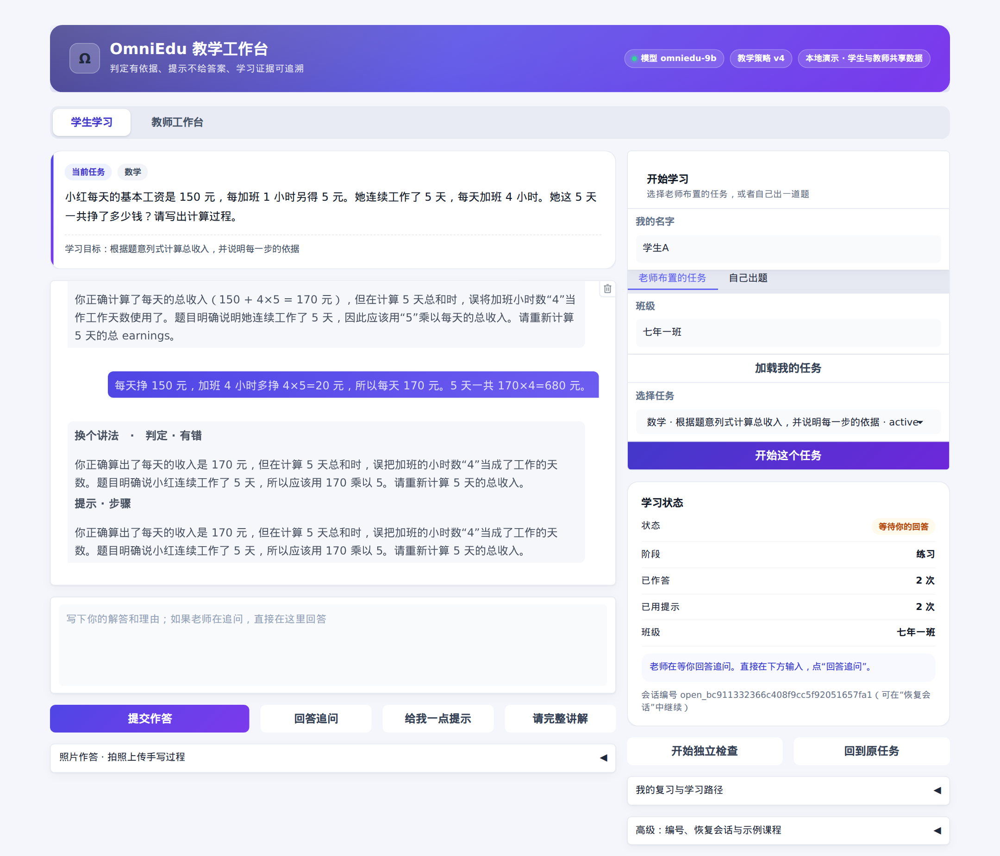
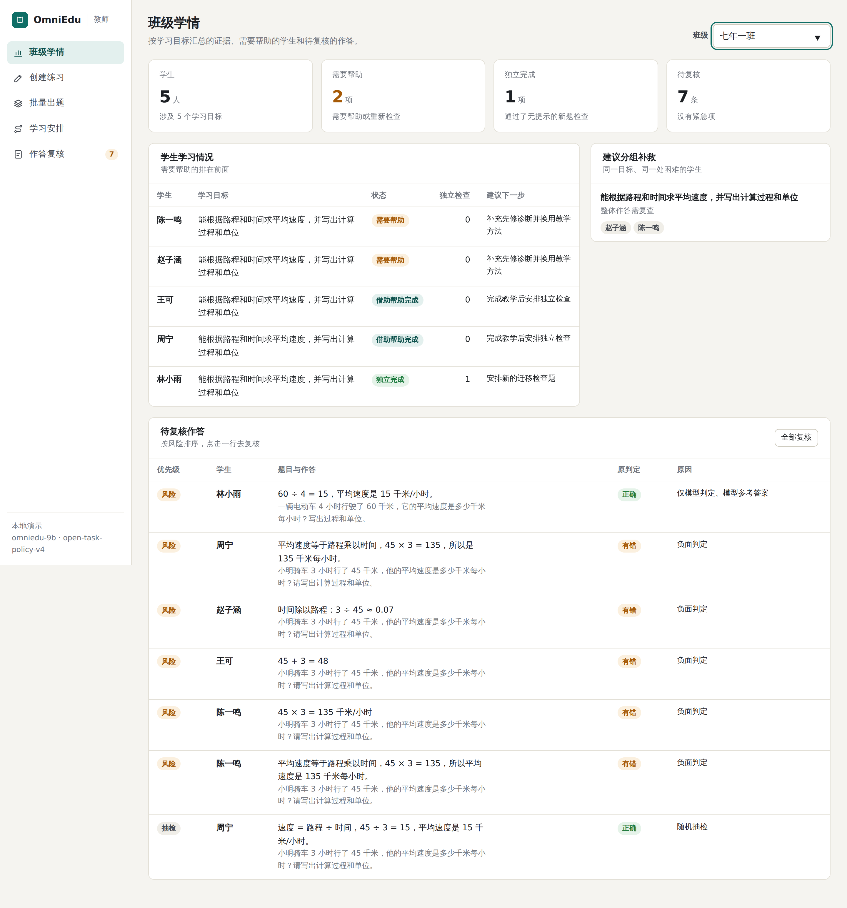
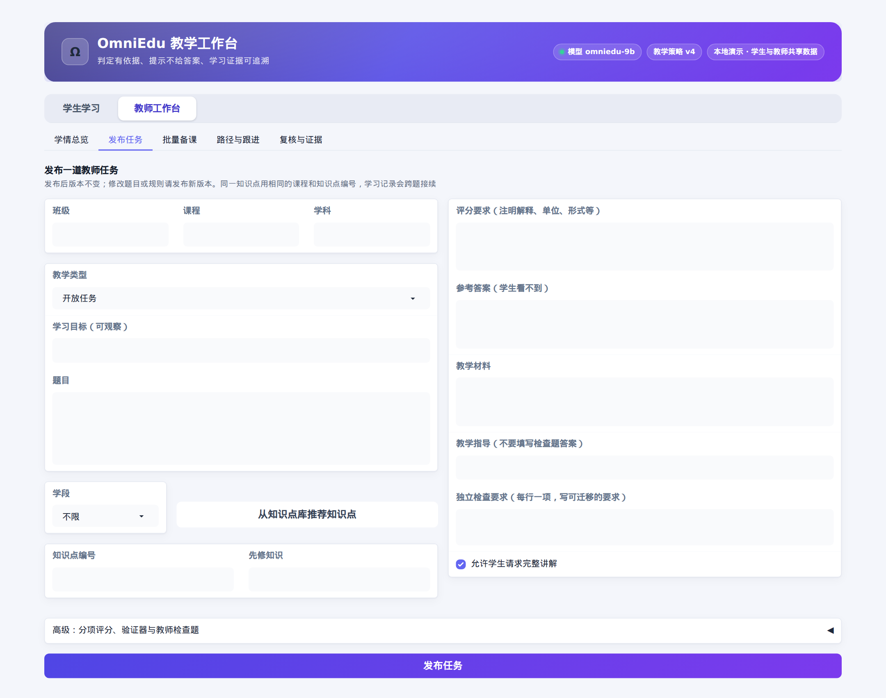

# OmniEdu 教学 Harness

给 [OmniEdu-9B](https://huggingface.co/lhpku20010120/Omni-Edu-9B) 加的一层教学执行系统：学生在这里做教师布置的任务，系统判断作答、决定下一步怎么教、生成并审核回复，把每一步的证据记下来，交给教师复核。

模型负责理解和表达；**是否答对、是否学会，由服务器按可核对的证据决定**。当前版本 v0.9.0。

## 为什么需要它

直接让大模型辅导学生，主要有三个问题：把错的判成对的、直接说出答案、说"你已经掌握了"却没有依据。这个 harness 针对这三点：

| 问题 | 做法 |
|---|---|
| 误判 | 判定必须逐字引用学生原文，引不出或没把握就转教师；可用的确定性工具（代数、数值、单位等）优先；可选第二个模型（Qwen3.5-27B）复核负面判定 |
| 泄露答案 | 每条回复先审核（泄露答案、事实错误、冒充系统、语言不符），不合格带理由重写一次，仍不合格用固定兜底句 |
| 虚假掌握 | 模型不能写学习结论；练习完成、辅助完成、模型评估的独立检查、工具验证的独立检查分开记录；"懂了"不算正确；独立检查必须是未见过的新题 |

此外：教学动作由有版本号的纯函数策略决定，每轮的输入、决策、候选回复和审核结果都记入轨迹，可以不调用模型重放；教师改判后，依赖这条证据的后续会话和任务会连带失效。

## 效果

对照对象是不加 harness 的同一模型（OmniEdu-9B）和基座 Qwen3.5-9B，裁判和模拟学生为 Qwen3.5-27B。详见 [HARNESS_REVIEW.md](HARNESS_REVIEW.md) 第七至十节。

| 评测 | 裸模型 | harness |
|---|---|---|
| 错误解答被判为正确（英文数学 StepVerify，400 份） | 35–46%；给参考答案后 13% | **1.5%**，转教师 2.5% |
| 错误解答被判为正确（中文数学，392 份） | 50–77%；给参考答案后 13–23% | **2.0%**，转教师 1.8% |
| 单轮辅导回复（MRBench，145 段） | 找出错误 0.97，泄露 0–1.4% | 找出错误 0.93–0.98，泄露 0–2% |
| 多轮对话，模拟学生解出率（40–60 题） | 0.85–1.00 | 0.88–0.96 |

harness 的主要价值在判定可靠性；回复质量与裸模型大致持平；多轮对话中对"索要答案"型学生略低于裸模型，因为它坚持不给答案。所有结果来自模型裁判和模拟学生，**没有真实师生参与**，不能当作学习效果证据。

## 快速开始

以下命令以 bysz1（`/default-filesys/workspace/ysb/Edu`）为例。启动脚本只使用空闲 GPU（其他进程占用超过 1GB 时拒绝启动），不会结束别人的进程。

```bash
cd /default-filesys/workspace/ysb/Edu
.envs/harness/bin/python scripts/service.py start inference   # OmniEdu-9B，vLLM，GPU 1，端口 8000
.envs/harness/bin/python scripts/service.py start harness     # 应用，端口 7860
.envs/harness/bin/python scripts/service.py status harness
```

在自己电脑上转发端口后打开 http://127.0.0.1:7860 ，接口文档在 http://127.0.0.1:7860/docs ：

```bash
ssh -N -L 7860:127.0.0.1:7860 bysz1
```

可选功能：

```bash
# 知识点库：下载 K12-KGraph 并导入 data/knowledge.sqlite（仅限研究和非商业教学，见“许可”）
.envs/harness/bin/python scripts/import_kgraph.py

# 交叉复核：启动 Qwen3.5-27B（GPU 3，端口 8002），再带环境变量重启应用
.envs/harness/bin/python scripts/service.py start judge
.envs/harness/bin/python scripts/service.py stop harness
OMNIEDU_REVIEW_BASE_URL=http://127.0.0.1:8002/v1 .envs/harness/bin/python scripts/service.py start harness
```

停止：`scripts/service.py stop harness|inference|judge|baseline`。服务不随服务器重启自动启动。日志在 `logs/`，学习记录在 `data/learning.sqlite`，图片在 `data/learning-images/`。

## 使用流程

页面分“学生学习”和“教师工作台”两部分。



**学生学习**：在右侧填写班级，加载老师布置的任务，或在“自己出题”里输入任意学科的题目（可附题目图片、文字材料或文字版 PDF）。左侧是任务卡片和与老师的对话：提交作答后，系统指出问题所在并追问；可以要提示（依次为概念、步骤、半完成的同构例子）、请求完整讲解（之后的完成记为辅助完成）、拍照上传手写过程（先确认识别结果再判定）。答对后可开始一道没见过的独立检查题。



**教师工作台**有五个子页：

1. **学情总览**：学生数、需要帮助、独立完成、待复核四项指标；每个学生在各学习目标上的状态和建议的下一步；建议分组补救的学生；按风险排序的待复核作答，点击一行即可去复核。
2. **发布任务**：填写班级、课程、题目、评分要求和参考答案，可附材料和最多 4 项分项标准。导入知识点库后，可点“从知识点库推荐知识点”自动填入知识点和先修，教师确认后发布。
3. **批量备课**：列出最多 6 个学习目标，由模型起草，逐题审核编辑后一次发布给学生名单。
4. **路径与跟进**：用知识点和先修关系发布课程路径，系统给出每个学生的下一步；按名单批量布置补救、复习或诊断任务。
5. **复核与证据**：确认或修改判定（依赖这条证据的记录连带失效），查看每轮的教学决策、候选回复和审核结果，回放策略决策，查看原始图片。



学生答错时的默认处理（策略 `open-task-policy-v4`）：如果判定能定位到学生原文中的具体问题，就指出那一步并追问，不给正确结果，例如“请再检查这一处：‘her base pay is 150 x 4 = 600’，这一步依据的是什么？”。

## 接口

完整字段见 `/docs`。写入接口都带 `request_id`（幂等）和可选 `version`（版本冲突返回 409）；模型不可用返回 503，可用相同 `request_id` 重试。

| 接口 | 用途 |
|---|---|
| `POST /api/teacher/assignments` | 发布教师任务 |
| `POST /api/teacher/packs`、`.../packs/generate`、`.../packs/{id}/publish` | 批量备课：保存草稿、模型起草、审核发布 |
| `GET /api/learning/inbox?class_id=&learner=` | 学生任务箱（不含参考答案） |
| `POST /api/sessions` | 开始会话（`learner` + `assignment_id`，或自定义 `task`、`material`、`image_url`） |
| `POST /api/sessions/{sid}/{action}` | 会话操作，见下表 |
| `GET /api/teacher/dashboard?class_id=` | 班级学情与待复核队列 |
| `POST /api/teacher/tasks/{sid}/attempts/{event_id}/corrections` | 教师改判（依赖证据连带失效） |
| `POST /api/teacher/tasks/{sid}/attempts/{event_id}/reviews` | 确认原判定 |
| `GET /api/teacher/sessions/{sid}/trace`、`/replay` | 教学轨迹、不调用模型的策略回放 |
| `POST /api/teacher/paths`、`GET /api/learning/next` | 课程路径、下一步建议 |
| `POST /api/teacher/followups`、`PATCH /api/teacher/followups/{id}` | 批量跟进任务、延期或撤销 |

| action | 用途 |
|---|---|
| `attempt` | 提交作答 |
| `reply` | 回答追问（不算作答证据） |
| `hint` / `explain` | 请求下一级提示 / 完整讲解 |
| `check` / `resume_practice` | 开始独立检查 / 回到原任务 |
| `image` / `confirm` / `confirm_task` | 上传作答图片 / 确认转写 / 确认题目图片 |

默认是**本地可信演示模式**，页面上的教师、学生只是视图，不是身份认证；服务只监听 127.0.0.1。共享使用时设置 `HARNESS_ACCOUNTS_FILE`（令牌到角色、班级、学生的 JSON 映射，请求带 `Authorization: Bearer <token>`），此时只开放 API、关闭演示页面；目前没有带登录的网页。

## 配置

| 环境变量 | 默认 | 作用 |
|---|---|---|
| `OMNIEDU_BASE_URL` / `OMNIEDU_MODEL` | `http://127.0.0.1:8000/v1` / `omniedu-9b` | 主模型 |
| `OMNIEDU_REVIEW_BASE_URL` / `OMNIEDU_REVIEW_MODEL` | 未设置 / `qwen3.5-27b` | 设置后开启交叉复核 |
| `OMNIEDU_POLICY` | `open-task-policy-v4` | 教学策略；可选 v1–v5，旧轨迹按原版本回放 |
| `OMNIEDU_PROMPT_STYLE` | `mixed` | `mixed`：评分和知识点用 OmniEdu 训练时的系统指令；`omniedu`：全部调用都用；`harness`：全部用自写提示词 |
| `OMNIEDU_JSON_SCHEMA` | `1` | 结构化输出使用 `json_schema` 约束解码 |
| `OMNIEDU_IMAGE_MAX_SIDE` | `1536` | 图片缩放的最长边像素 |
| `HARNESS_DB` / `OMNIEDU_KNOWLEDGE_DB` | `data/learning.sqlite` / `data/knowledge.sqlite` | 数据库路径 |
| `HARNESS_ACCOUNTS_FILE` | 未设置 | 认证模式的账号文件 |

推理服务参数在 `service-config.json`：vLLM 0.23.0，GPU 1，BF16，上下文 32768，最多 32 路并发，显存 60%。

## 架构

一次作答的处理顺序：

```
学生作答 → 确定性工具验证（能用时）→ 模型评分（必须引用学生原文）→ 可选 27B 复核
        → 纯函数策略选择教学动作 → 模型写回复 → 审核（不合格重写一次 / 兜底）
        → 一个事务内写入证据、状态差异和轨迹
```

代码按职责分目录，主流程从 `app.py` → `interfaces/api.py` → `core/open_engine.py` 阅读：

```text
harness/
├── app.py            # 应用组装与启动入口
├── errors.py         # 共享异常
├── paths.py          # 项目根目录与资源路径
├── interfaces/       # HTTP 接口、权限、Gradio 页面与样式
├── core/             # 会话调度、任务协议、教学策略、证据与记忆
├── grading/          # 作答评分、分项评分、代数验证
├── teaching/         # 教师任务、复核、路径跟进、批量备课
├── resources/        # 知识点库、图片、材料与检索
├── llm/              # 模型客户端、教学适配器、提示词
├── persistence/      # SQLite 事务快照与调用重放
└── legacy/           # 旧版固定代数课程兼容实现
```

| 模块 | 职责 |
|---|---|
| `harness/core/open_engine.py` | 会话生命周期、操作调度、共享事务与幂等；组合各功能 mixin，保留 `OpenEngine` 入口 |
| `harness/grading/engine_grading.py`、`core/engine_feedback.py` | 作答与分项评分、证据绑定、交叉复核；回复生成、审核、重写与兜底 |
| `harness/teaching/engine_teacher.py` | 发布任务、学情总览、轨迹回放、教师复核和改判传播 |
| `harness/resources/engine_knowledge.py`、`teaching/engine_planning.py`、`teaching/engine_preparation.py` | 知识点推荐与校验；课程路径、跟进和任务箱；备课包生成、编辑与发布 |
| `harness/core/evidence.py` | 原文引用核对、学生可见字段投影、复核风险与固定反馈模板 |
| `harness/core/tasks.py` | 任务协议、评分结构、教学策略 v1–v5 |
| `harness/llm/open_model.py`、`llm/model.py`、`llm/omniedu_prompts.py` | 模型调用：评分、回复、审核、翻译；结构化输出；系统指令 |
| `harness/grading/assessment.py`、`grading/criteria.py`、`resources/toolbox.py`、`grading/algebra.py` | 判定聚合、分项评分器、代数验证、材料切块与 BM25 检索 |
| `harness/teaching/teacher.py`、`teaching/planning.py`、`teaching/preparation.py` | 教师任务、课程路径与跟进、批量备课 |
| `harness/core/memory.py` | 从事件重建跨会话学习记录和复习间隔 |
| `harness/resources/knowledge.py` | 知识点库与自动打标 |
| `harness/persistence/storage.py`、`persistence/replay.py` | SQLite 快照事务；并发冲突时持写锁重算，复用已完成的模型调用 |
| `harness/resources/images.py`、`resources/materials.py` | 图片规范化与按哈希存文件；PDF 按页提取 |
| `harness/app.py` | 应用组装、权限中间件与兼容入口；`create_app(get_engine, with_ui=False)` 可只组装 API |
| `harness/interfaces/api.py` | HTTP 请求协议、路由与异常到状态码的映射 |
| `harness/interfaces/web.py`、`interfaces/ui.py` | Gradio 页面构建与回调；主题、样式与卡片渲染 |
| `inference_server.py`、`scripts/service.py` | Transformers 后备推理服务；服务启停 |

功能 mixin 使用 `OpenEngine` 提供的事务、模型和会话方法，不独立创建运行时；跨功能写入继续共享同一个事务。API 和页面通过传入的 `get_engine` 获取运行时，不反向导入应用入口。启动入口仍为 `harness.app:app`。

`legacy/engine.py`、`legacy/course.py`、`legacy/policy.py`、`legacy/runtime.py` 是早期固定代数课程的实现，只为兼容旧会话保留；`core/gateway.py` 根据会话类型路由到旧课程或开放任务引擎。

## 测试与评测

```bash
.envs/harness/bin/python -m pytest -q tests                        # 单元测试（假模型，临时数据库）
PYTHONPATH=scripts .envs/harness/bin/python scripts/teaching_v08_e2e.py   # 真实模型回归（需 27B 服务）
.envs/harness/bin/python scripts/teaching_v071_e2e.py               # 真实模型回归（只需主模型），另有 teaching_v06_e2e.py
```

对照评测需要裁判（`service.py start judge`，GPU 3）和基线模型（`start baseline`，GPU 4）：

```bash
.envs/harness/bin/python scripts/benchmark.py correctness correctness-zh correctness-multi response \
  --systems raw-baseline,raw-omniedu,raw-baseline-ref,raw-omniedu-ref,harness-omniedu,harness-omniedu-xr
.envs/harness/bin/python scripts/benchmark.py dialogue --persona gamer --limit 40 \
  --systems raw-baseline,raw-omniedu,harness-omniedu
.envs/harness/bin/python scripts/eval_knowledge.py                 # 知识点打标（需 references/k12-kgraph/ 下的图谱和 K12-Bench 文件）
```

模拟学生类型：`cooperative`（配合）、`persistent`（坚持错误）、`gamer`（索要答案）、`disengaged`（敷衍）。报告写入 `reports/benchmark/`。中文和五科判定集由 `bench/build_data.py` 生成，已存于 `bench/data/`。

## 已知限制

- 没有真实教师盲评或课堂试验。
- 存储是 SQLite，请求同步等待模型；40 名学生同时提交已验证可用，更大规模未验证。
- 知识点库只有人教版数理化生，没有语文、英语和其他版本；打标“至少命中一个”约 80%。
- PDF 只支持文字版，扫描件要按图片上传；检索是 BM25，没有向量检索。
- 复习间隔是 1/3/7/14/30 天的固定规则，掌握情况没有概率估计（未用 BKT、IRT、FSRS）。
- 没有批量批改拍照作业、学情讲评、组卷等教师功能，没有带登录的网页。
- 编程类任务没有运行学生代码的沙箱。

## 环境与模型

- 模型：`lhpku20010120/Omni-Edu-9B`，revision `7fda599d16f5c7aff770e2869450684c8e4d72f0`，BF16，存于 `models/Omni-Edu-9B`。下载：`HF_ENDPOINT=https://hf-mirror.com .envs/harness/bin/python scripts/download_model.py`。
- 环境：应用 `.envs/harness`（Python 3.11，`requirements-harness.lock`），推理 `.envs/vllm`（Python 3.12，`requirements-vllm.lock`），用 `scripts/bootstrap_vllm.sh` 重建。vLLM 通过 `/usr/local/cuda-13.0/compat` 在 550 驱动上运行，不改系统驱动。
- 后备：`.envs/inference` 中的 Transformers 服务，`scripts/service.py start inference --backend transformers`（使用 GPU 1、2）。
- 旧库中的内联图片可用 `scripts/migrate_images.py --apply` 迁移为文件（先自动备份）。

## 许可

- OmniEdu 模型：Apache-2.0，可商用。
- K12-KGraph（知识点库数据）：CC BY-NC-SA 4.0，**只能用于研究和非商业教学**；数据和导入后的库文件不进仓库。
- 评测使用的公开数据集（MRBench、StepVerify、MathTutorBench 等）按各自许可使用。

## 相关文档

- [HARNESS_REVIEW.md](HARNESS_REVIEW.md)：评估报告、逐项处理状态和全部评测结果。
- [CHANGELOG.md](CHANGELOG.md)：各版本的更新说明。
- [REFERENCES.txt](REFERENCES.txt)：设计参考来源。
