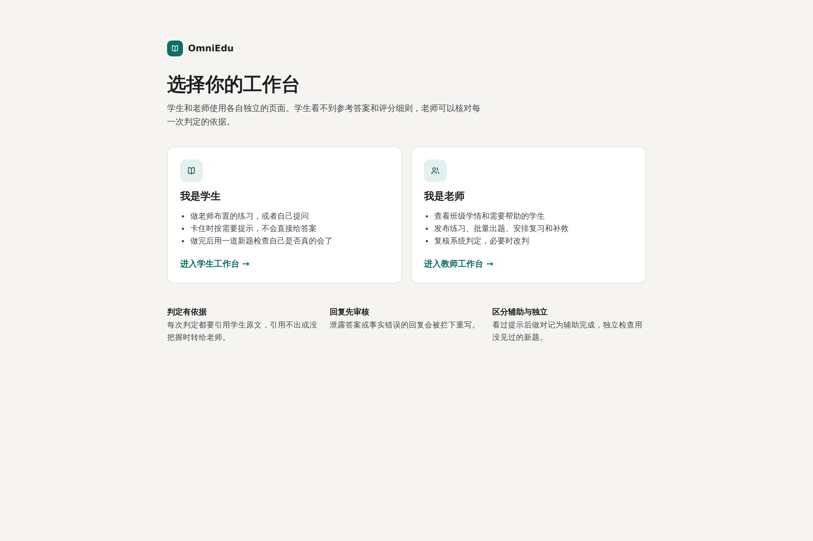
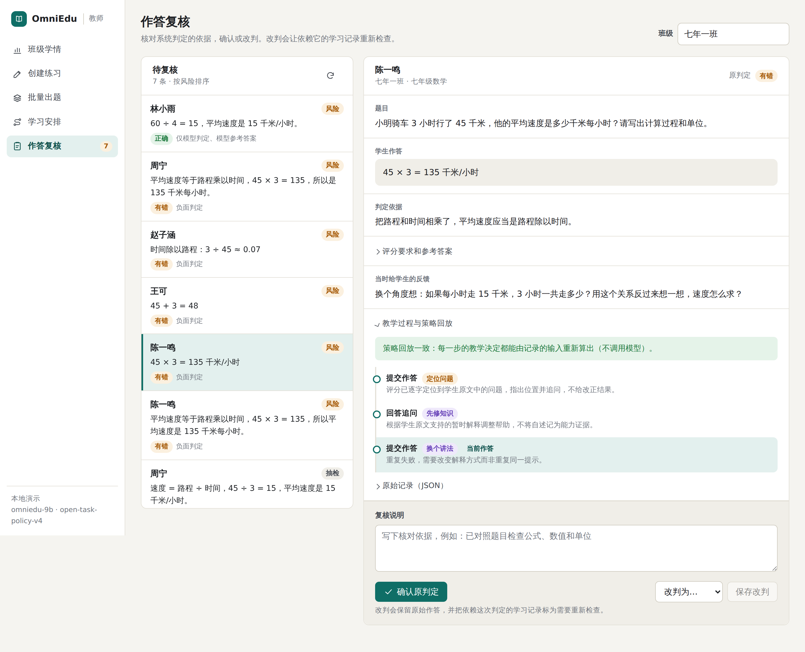

# OmniEdu 教学 Harness

给 [OmniEdu-9B](https://huggingface.co/lhpku20010120/Omni-Edu-9B) 加的一层教学执行系统。学生在这里做老师布置的练习或自己提问；系统判断作答、决定下一步怎么教、生成回复并审核，把每一步的依据记录下来，交给老师复核。

核心原则：**模型负责理解学生的话和写回复；答没答对、学没学会，由服务器按可以核对的证据决定。**

当前版本 v0.10.0。功能在真实模型和真实浏览器中验收过（[功能与测试记录](docs/FEATURES_AND_TESTS.md)）；**还没有真实师生参与的教学效果评估**。

## 目录

- [它解决什么问题](#它解决什么问题)
- [效果](#效果)
- [快速开始](#快速开始)
- [使用说明](#使用说明)
- [部署模式与权限](#部署模式与权限)
- [接口](#接口)
- [配置](#配置)
- [架构](#架构)
- [开发与测试](#开发与测试)
- [已知限制](#已知限制)
- [环境、许可与相关文档](#环境许可与相关文档)

## 它解决什么问题

直接让大模型辅导学生，主要有三个风险：把错的判成对的、直接说出答案、没有依据就说“你已经掌握了”。研究也表明，不加约束的 AI 辅导会让学生依赖它，撤掉以后考试成绩反而下降（见[调研文档](docs/EDU_HARNESS_RESEARCH.md)）。这个 harness 的做法：

| 风险 | 做法 |
|---|---|
| 误判 | 判定必须逐字引用学生原文，服务器核对引用，引不出或没把握就转老师；能用确定性工具（代数、数值、单位等）核对的部分以工具为准；可选第二个模型（Qwen3.5-27B）复核负面判定 |
| 泄露答案 | 每条回复先审核（泄露答案、事实错误、冒充系统、语言不符），不合格带理由重写一次，仍不合格就用服务器的固定兜底句 |
| 虚假掌握 | 模型不能写学习结论；练习完成、借助帮助完成、模型评估的独立检查、工具验证的独立检查分开记录；学生说“懂了”不算数；独立检查必须用没见过的新题 |

另外：下一步怎么教由一个有版本号的纯函数策略决定，不交给模型；每一轮的输入、决定、候选回复和审核结果都记入轨迹，可以不调用模型重放；老师改判后，依赖这条证据的后续会话和任务会连带失效。

一次作答的处理顺序：

```
学生作答
 → 确定性工具验证（能用时）
 → 模型评分：必须引用学生原文；引不出或没把握 → 转老师
 → 可选：27B 复核负面判定
 → 纯函数策略决定教学动作（定位问题、追问、分级提示、讲解、转老师……）
 → 模型按这个动作写回复 → 审核（不合格重写一次 / 兜底）
 → 在一个事务里写入证据、状态变化、证据依赖和轨迹
```

## 效果

对照对象是不加 harness 的同一模型（OmniEdu-9B）和基座 Qwen3.5-9B，裁判和模拟学生为 Qwen3.5-27B。详见 [HARNESS_REVIEW.md](HARNESS_REVIEW.md) 第七至十节。

| 评测 | 裸模型 | harness |
|---|---|---|
| 错误解答被判为正确（英文数学 StepVerify，400 份） | 35–46%；给参考答案后 13% | **1.5%**，转老师 2.5% |
| 错误解答被判为正确（中文数学，392 份） | 50–77%；给参考答案后 13–23% | **2.0%**，转老师 1.8% |
| 单轮辅导回复（MRBench，145 段） | 找出错误 0.97，泄露 0–1.4% | 找出错误 0.93–0.98，泄露 0–2% |
| 多轮对话，模拟学生解出率（40–60 题） | 0.85–1.00 | 0.88–0.96 |

如何理解这些数字：

- harness 的主要价值在**判定可靠性**；回复质量和裸模型大致持平；面对“索要答案”型的模拟学生，解出率略低于裸模型，因为它坚持不给答案。
- 所有结果都来自模型裁判和模拟学生，**没有真实师生参与，不能当作学习效果的证据**。
- 开启交叉复核的配置（`harness-omniedu-xr`）里，复核模型和裁判都是 Qwen3.5-27B，这一组结果可能偏高；要得出可靠结论，需要换一个不同来源的裁判重跑。

## 快速开始

### 只看界面（不需要 GPU）

`scripts/ui_preview.py` 用一个脚本化的模型和一个示例班级启动服务，适合看界面、走流程。它的回复是写好的固定内容，不能用来判断教学质量。

```bash
cd /default-filesys/workspace/ysb/Edu
.envs/harness/bin/python scripts/ui_preview.py --port 7862
```

在自己电脑上转发端口后打开 http://127.0.0.1:7862 。学生端可以填名字“陈一鸣”或“周宁”、班级“七年一班”；教师端打开后会自动选中这个班级。

```bash
ssh -N -L 7862:127.0.0.1:7862 bysz1
```

### 完整部署（真实模型）

以下命令以 bysz1 为例。启动脚本只使用空闲 GPU（其他进程占用超过 1GB 时拒绝启动），不会结束别人的进程。

```bash
cd /default-filesys/workspace/ysb/Edu
.envs/harness/bin/python scripts/service.py start inference   # OmniEdu-9B，vLLM，GPU 1，端口 8000
.envs/harness/bin/python scripts/service.py start harness     # 应用，端口 7860
.envs/harness/bin/python scripts/service.py status harness
```

转发 7860 端口后打开 http://127.0.0.1:7860 ，接口文档在 http://127.0.0.1:7860/docs 。

可选功能：

```bash
# 交叉复核：启动 Qwen3.5-27B（GPU 3，端口 8002），再带环境变量重启应用
.envs/harness/bin/python scripts/service.py start judge
.envs/harness/bin/python scripts/service.py stop harness
OMNIEDU_REVIEW_BASE_URL=http://127.0.0.1:8002/v1 .envs/harness/bin/python scripts/service.py start harness

# 知识点库：下载 K12-KGraph 并导入 data/knowledge.sqlite（仅限研究和非商业教学，见“许可”）
.envs/harness/bin/python scripts/import_kgraph.py
```

停止服务：`scripts/service.py stop harness|inference|judge|baseline`。服务不会随服务器重启自动启动。日志在 `logs/`，学习记录在 `data/learning.sqlite`，图片在 `data/learning-images/`。

## 使用说明

首页选择“我是学生”或“我是老师”，分别进入 `/student/` 和 `/teacher/`。两个工作台是独立的页面，学生端的代码里不会请求参考答案和评分细则。页面适配手机，跟随系统的深色模式。下面的截图来自预览服务，学生和作答都是示例数据。



### 学生


- **开始**：第一次进入时填写名字和班级（班级模式下由账号决定）。左侧列出老师布置的任务；也可以“自己提一个问题”，任何学科都行，可以附题目照片、文字材料或文字版 PDF。
- **作答**：提交后，系统指出问题所在并追问，追问显示在高亮的问题框里。回答追问默认算对话，不算作答；勾选“完整解答”才按作答判定。
- **求助**：可以请求提示，依次是概念（点明所求量的含义）、步骤（说明要用的规则或公式，但不代入本题数字）、例子（换了数据的同类题）；也可以请求完整讲解，请求前会先确认，因为看过讲解后做对会记为“借助帮助完成”。讲解给出完整步骤，并以“最终答案”结尾。
- **拍照作答**：上传手写过程的照片，先核对、修改识别出的文字，确认后才判定。
- **独立检查**：练习完成后，可以做一道没见过的新题来检查自己，检查中不提供提示和讲解。
- **学习路径**：输入老师给的路径编号，查看系统按学习证据推荐的下一步。
- 会话自动保存在本机，刷新后继续；换设备可以用会话编号恢复。

### 老师


右上角选择班级。班级不需要事先创建：填一个新名字就是一个新班级，学生填同样的名字就能收到任务。左侧五个页面：

1. **班级学情**：学生数、需要帮助、独立完成、待复核四项指标；每个学生在各个学习目标上的状态（需要帮助的排在前面）和建议的下一步；建议分组补救的学生；按风险排序的待复核作答，点击一行直接去复核。
2. **创建练习**：课程、学科、教学类型、学习目标、题目、评分要求、参考答案、独立检查要求。展开后可以附材料（可从文件导入）、设置最多 4 项分项评分、绑定代数验证（可先“核对”），以及从本班已发布的练习中勾选检查题库。导入知识点库后可以“从知识点库推荐”。表单会自动保存草稿。发布后可以一键去“学习安排”布置给学生。
3. **批量出题**：列出最多 6 个学习目标，由模型起草题目；逐题编辑后保存为新版本（编辑会取消“已核对”的勾选），填写分发名单和审核说明后一次发布。
4. **学习安排**：从本班练习中选择，按名单布置补救、复习或诊断，可以延期或撤销；发布学习顺序（知识点、练习、先修），可以按知识点库补全先修。
5. **作答复核**：左侧是待复核队列，右侧是题目、学生作答、原始照片、判定依据、分项结果、评分要求与参考答案、当时给学生的反馈，以及每一轮的教学决定与策略回放。填写复核说明后，确认原判定或改判。



学生答错时的默认处理（策略 `open-task-policy-v4`）：如果判定能定位到学生原文中的具体问题，就指出那一步并追问，不给正确结果。真实模型验收中的一个例子：学生写了“45 × 3 = 135”，系统回复“平均速度表示每小时行多少千米，也就是把总路程按时间平均分。你算出的135比总路程45还大，这合理吗？”。

## 部署模式与权限

**本地演示模式**（默认）：学生的名字和班级由使用者自己填写，不是身份认证。服务只监听 127.0.0.1，适合单人或可信环境演示。

**班级模式**：设置 `HARNESS_ACCOUNTS_FILE`，指向一个“访问码 → 账号”的 JSON 文件：

```json
{"7f3a…": {"role": "teacher", "class_id": "七年一班"},
 "c91e…": {"role": "student", "class_id": "七年一班", "learner": "林小雨"}}
```

- 网页先要求输入访问码（保存在浏览器会话中，可以选择“记住我”）；所有 `/api` 请求都带 `Authorization: Bearer <访问码>`。
- 学生只能看到自己的会话和任务，身份不能修改；老师只能操作本班的数据；旧版示例课程和全局报表接口被禁用。
- 账号文件修改后立即生效，不必重启；文件读取失败时接口返回 503，不会放行。
- 每个接口的检查都写在路由里（`interfaces/access.py` 的 `Guard`），`tests/test_access.py` 会检查有没有遗漏的路由。

## 接口

完整字段见 `/docs`。写入接口都带 `request_id`（重复提交返回同一结果）和可选的 `version`（版本冲突返回 409）；模型不可用时返回 503，可以用相同的 `request_id` 重试。

| 接口 | 用途 |
|---|---|
| `POST /api/sessions` | 开始会话（`learner` 加 `assignment_id` / `followup_id`，或自定义 `task`、`material`、`image_url`） |
| `GET /api/sessions/{sid}`、`POST /api/sessions/{sid}/{action}` | 读取会话；会话操作，见下表 |
| `GET /api/learning/inbox`、`/learning/followups`、`/learning/next` | 学生的任务箱（不含参考答案）、复习与补救任务、学习路径的下一步 |
| `POST /api/teacher/assignments`、`GET /api/teacher/assignments?class_id=` | 发布练习；本班练习列表（不含参考答案） |
| `POST /api/teacher/packs`、`.../packs/generate`、`PUT .../packs/{id}`、`POST .../packs/{id}/publish` | 批量出题：保存、模型起草、编辑为新版本、审核发布 |
| `GET /api/teacher/dashboard?class_id=` | 班级学情、待复核队列、已布置的任务 |
| `GET /api/teacher/tasks/{sid}/attempts/{event_id}` | 一份作答的复核详情 |
| `POST .../attempts/{event_id}/reviews`、`.../corrections` | 确认原判定；改判（依赖它的证据连带失效） |
| `GET /api/teacher/sessions/{sid}/trace`、`/replay` | 教学轨迹；不调用模型的策略回放 |
| `POST /api/teacher/paths`、`POST /api/teacher/followups`、`PATCH /api/teacher/followups/{id}` | 学习顺序；布置复习与补救；延期或撤销 |
| `GET /api/me`、`/api/meta`、`/api/teacher/classes` | 当前账号；教学类型、评分项类型、模型与知识点库状态；已有班级 |
| `POST /api/materials/extract` | 上传 .txt / .md / 文字版 PDF，返回文字 |
| `POST /api/teacher/algebra/preview`、`GET /api/teacher/knowledge/suggest`、`/knowledge/nodes/{id}` | 核对代数验证绑定；知识点推荐；知识点详情 |

| action | 用途 |
|---|---|
| `attempt` | 提交作答 |
| `reply` | 回答追问（不算作答证据） |
| `hint` / `explain` | 请求下一级提示 / 完整讲解 |
| `check` / `resume_practice` | 开始独立检查 / 回到原任务 |
| `image` / `confirm` / `confirm_task` | 上传作答照片 / 确认识别文字 / 确认题目照片 |

会话数据中，每一轮都有 `action`（策略决定的动作）和 `delivered_action`（学生实际收到的回复类型）。两者不同，说明候选回复没通过审核，被服务器的兜底句或模板替换了。

## 配置

| 环境变量 | 默认 | 作用 |
|---|---|---|
| `OMNIEDU_BASE_URL` / `OMNIEDU_MODEL` | `http://127.0.0.1:8000/v1` / `omniedu-9b` | 主模型 |
| `OMNIEDU_REVIEW_BASE_URL` / `OMNIEDU_REVIEW_MODEL` | 未设置 / `qwen3.5-27b` | 设置后开启交叉复核 |
| `OMNIEDU_POLICY` | `open-task-policy-v4` | 教学策略，可选 v1–v5；旧轨迹按原版本回放 |
| `OMNIEDU_PROMPT_STYLE` | `mixed` | `mixed`：评分和知识点调用用 OmniEdu 训练时的系统指令；`omniedu`：全部调用都用；`harness`：全部用自写提示词 |
| `OMNIEDU_JSON_SCHEMA` | `1` | 结构化输出使用 `json_schema` 约束解码 |
| `OMNIEDU_IMAGE_MAX_SIDE` | `1536` | 图片缩放后的最长边像素 |
| `HARNESS_DB` / `OMNIEDU_KNOWLEDGE_DB` | `data/learning.sqlite` / `data/knowledge.sqlite` | 数据库路径 |
| `HARNESS_ACCOUNTS_FILE` | 未设置 | 设置后进入班级模式 |

推理服务参数在 `service-config.json`：vLLM 0.23.0，GPU 1，BF16，上下文 32768，最多 32 路并发，显存 60%。

## 架构

建议的阅读顺序：`app.py` → `interfaces/api.py` → `core/open_engine.py`。

```text
harness/
├── app.py            # 应用组装：API 加上静态页面
├── interfaces/       # HTTP 接口、逐路由权限、静态网页（static/）
├── core/             # 会话调度、状态类型、任务协议与教学策略、证据、记忆、证据依赖
├── grading/          # 作答评分、分项评分、代数验证
├── teaching/         # 练习、复核与改判、学习路径与跟进、批量出题
├── resources/        # 知识点库、图片、材料与检索
├── llm/              # 模型客户端、提示词
├── persistence/      # SQLite 事务与模型调用重放
└── legacy/           # 早期固定代数课程（只为兼容旧会话保留）
```

| 模块 | 职责 |
|---|---|
| `core/open_engine.py` | 会话生命周期、操作调度、事务与幂等；组合各功能 mixin |
| `core/state.py` | 会话状态的类型定义（`SessionState`、`Turn`），所有状态字段集中说明 |
| `core/tasks.py` | 任务协议、教学策略 v1–v5（纯函数） |
| `core/evidence.py` | 原文引用核对、学生可见字段、复核风险、固定反馈模板 |
| `core/dependencies.py` | 证据依赖表：记录每一轮引用了哪些会话的证据，改判时沿依赖传播失效 |
| `core/memory.py` | 从事件重建跨会话的学习记录和复习间隔 |
| `core/engine_feedback.py`、`grading/engine_grading.py` | 回复生成、审核、重写与兜底；作答与分项评分、交叉复核 |
| `grading/assessment.py`、`grading/criteria.py`、`grading/algebra.py` | 判定聚合、分项评分器、代数验证 |
| `teaching/engine_teacher.py`、`teacher.py` | 练习、班级学情、轨迹回放、复核与改判 |
| `teaching/engine_planning.py`、`planning.py` | 学习顺序、复习与补救任务、任务箱 |
| `teaching/engine_preparation.py`、`preparation.py` | 练习包的生成、编辑与发布 |
| `resources/` | 知识点库与打标、图片规范化与存储、PDF 提取、材料切块与 BM25 检索 |
| `llm/open_model.py`、`llm/model.py`、`llm/omniedu_prompts.py` | 模型调用（评分、回复、审核、翻译）、结构化输出、系统指令 |
| `persistence/storage.py`、`persistence/replay.py` | WAL 读快照事务；快照过期时重算，复用已完成的模型调用 |
| `interfaces/access.py`、`interfaces/api.py` | 班级模式账号与逐路由权限；请求协议、路由、错误码 |
| `interfaces/static/` | `common.js`（API、转义、图标、登录）、`student.js`、`teacher.js`、`app.css` |
| `core/gateway.py` | 按会话类型路由到开放任务引擎或旧示例课程引擎 |

几个关键设计：

- **事务与并发**：每个操作在 SQLite WAL 的读快照里计算，调用模型时不持有任何锁，写入都放在最后。如果期间有其他操作提交，SQLite 拒绝在过期的快照上写入，系统就带着已有的模型结果重算一次，不会重复调用模型。规则是“事务中不能先写库、再调用模型”，违反会触发 `WriteBeforeModelCall` 警告，测试中视为错误。
- **证据失效**：每一轮生成上下文时引用了哪些会话的证据，都记在 `evidence_dependencies` 表里；老师改判时沿这张表找到所有受影响的会话。
- **权限**：每个 API 路由都显式调用 `Guard` 的检查，没有集中的路径匹配规则。
- **提示与讲解的把关**：每一级提示的标准写成一份规则（`llm/open_model.py` 的 `HINT_RULES`），写作和复核共用。程序另外检查：提示不得出现最终数值，不得用题目里的数字替学生列式；数值题的讲解必须出现最终答案。配置了复核模型时，提示和讲解由复核模型把关，被否决后也由它重写；模型的提示都被否决时，发出对应级别的服务器模板，阶梯不会中断。
- **功能 mixin**：各功能 mixin 使用 `OpenEngine` 的事务、模型和会话方法，不各自创建运行时；API 通过传入的 `get_engine` 获取运行时。启动入口是 `harness.app:app`。

## 开发与测试

```bash
.envs/harness/bin/python -m pytest -q tests          # 自动化测试：假模型、临时数据库，约 6 秒
ruff check harness tests && ruff format --check .    # 代码风格（配置在 pyproject.toml）
```

浏览器检查（需要 Playwright 和 Chromium）：

```bash
# 不需要 GPU：脚本化模型，桌面和手机尺寸走一遍主要流程，有页面脚本错误或横向溢出就失败
.envs/harness/bin/python scripts/ui_preview.py --port 7862 &
python scripts/capture_ui.py --url http://127.0.0.1:7862 --out docs/screenshots

# 真实模型验收：先用临时数据库在 7861 端口启动独立服务，再运行（不要用正式库）
HARNESS_DB=/tmp/edu-audit/learning.sqlite OMNIEDU_REVIEW_BASE_URL=http://127.0.0.1:8002/v1 \
  .envs/harness/bin/python -m uvicorn harness.app:app --host 127.0.0.1 --port 7861
python scripts/capture_functional_audit.py --url http://127.0.0.1:7861
```

真实模型脚本回归、提示阶梯与讲解的重复评测、存储性能测量：

```bash
PYTHONPATH=scripts .envs/harness/bin/python scripts/teaching_v071_e2e.py   # 只需主模型
PYTHONPATH=scripts .envs/harness/bin/python scripts/teaching_v08_e2e.py    # 需要 27B 复核模型
OMNIEDU_REVIEW_BASE_URL=http://127.0.0.1:8002/v1 .envs/harness/bin/python scripts/eval_hint_ladder.py --repeats 4
.envs/harness/bin/python scripts/bench_storage.py --learners 1000 --db /tmp/bench/big.sqlite
.envs/harness/bin/python scripts/bench_storage.py --db /tmp/bench/big.sqlite --concurrent 40
```

对照评测需要裁判（`service.py start judge`，GPU 3）和基线模型（`start baseline`，GPU 4）：

```bash
.envs/harness/bin/python scripts/benchmark.py correctness correctness-zh correctness-multi response \
  --systems raw-baseline,raw-omniedu,raw-baseline-ref,raw-omniedu-ref,harness-omniedu,harness-omniedu-xr
.envs/harness/bin/python scripts/benchmark.py dialogue --persona gamer --limit 40 \
  --systems raw-baseline,raw-omniedu,harness-omniedu
.envs/harness/bin/python scripts/eval_knowledge.py   # 知识点打标（需要 references/k12-kgraph/ 下的图谱和 K12-Bench 文件）
```

模拟学生类型：`cooperative`（配合）、`persistent`（坚持错误）、`gamer`（索要答案）、`disengaged`（敷衍）。报告写入 `reports/benchmark/`。中文和五科判定集由 `bench/build_data.py` 生成，已存于 `bench/data/`。

## 已知限制

**教学行为**
- 提示质量依赖复核模型：开启复核时，第二级提示约一半到三分之二是服务器模板（模型写的被否决）；只用 9B 时，解释类题目的提示可能直接给出结论，程序检查拦不住，**正式使用建议开启交叉复核**（见[功能与测试记录第 5 节](docs/FEATURES_AND_TESTS.md#5-提示阶梯与完整讲解的修复)）。
- 讲解是否完整，只有数值题有程序检查；解释类题目靠复核判断。
- 复习间隔是 1/3/7/14/30 天的固定规则，掌握情况没有概率估计（没有用 BKT、IRT、FSRS）。

**验证**
- 没有真实教师盲评或课堂试验；对话评测依赖模拟学生，而模拟学生的有效性本身有争议（见[调研文档](docs/EDU_HARNESS_RESEARCH.md)）。

**内容与功能**
- 知识点库只有人教版数理化生，没有语文、英语和其他版本；打标“至少命中一个”约 80%。
- PDF 只支持文字版，扫描件要按图片上传；检索是 BM25，没有向量检索。
- 没有批量批改拍照作业、学情讲评、组卷等教师功能；编程题没有运行学生代码的沙箱。
- 班级模式用访问码登录，没有账号管理界面，访问码需要手工写入账号文件。

**部署**
- 存储是 SQLite（WAL 模式），只适合单机单进程部署：WAL 依赖共享内存文件，多台机器同时访问共享盘上的同一个库是不安全的，那种部署需要换 PostgreSQL。
- 请求同步等待模型；任何一次提交都会让同时进行的其他操作重算一次（复用模型结果，只花毫秒级时间）。40 名学生同时提交已验证可用，更大规模未验证。

## 环境、许可与相关文档

**环境与模型**
- 模型：`lhpku20010120/Omni-Edu-9B`，revision `7fda599d16f5c7aff770e2869450684c8e4d72f0`，BF16，存于 `models/Omni-Edu-9B`。下载：`HF_ENDPOINT=https://hf-mirror.com .envs/harness/bin/python scripts/download_model.py`。
- 应用环境 `.envs/harness`（Python 3.11）。依赖列在 `pyproject.toml`；`requirements-harness.lock` 是 v0.9 时生成的，其中还有已经不再使用的 Gradio，尚未重新生成。
- 推理环境 `.envs/vllm`（Python 3.12，`requirements-vllm.lock`），用 `scripts/bootstrap_vllm.sh` 重建。vLLM 通过 `/usr/local/cuda-13.0/compat` 在 550 驱动上运行，不改系统驱动。
- 后备推理：`.envs/inference` 中的 Transformers 服务，`scripts/service.py start inference --backend transformers`（使用 GPU 1、2）。
- 旧库中的内联图片可以用 `scripts/migrate_images.py --apply` 迁移为文件（会先自动备份）。

**许可**
- OmniEdu 模型：Apache-2.0，可商用。
- K12-KGraph（知识点库数据）：CC BY-NC-SA 4.0，**只能用于研究和非商业教学**；数据和导入后的库文件不进仓库。
- 评测使用的公开数据集（MRBench、StepVerify、MathTutorBench 等）按各自的许可使用。

**相关文档**
- [docs/FEATURES_AND_TESTS.md](docs/FEATURES_AND_TESTS.md)：当前版本的功能说明，以及真实模型与浏览器验收记录。
- [docs/EDU_HARNESS_RESEARCH.md](docs/EDU_HARNESS_RESEARCH.md)：教育模型 harness 的作用、相关研究与开源实现、本项目的改进方向。
- [HARNESS_REVIEW.md](HARNESS_REVIEW.md)：评估报告、逐项处理状态和全部评测结果。
- [CHANGELOG.md](CHANGELOG.md)：各版本的更新说明。
- [REFERENCES.txt](REFERENCES.txt)：设计参考的开源项目来源。
- [docs/archive/FEATURES_AND_TESTS-v0.9.md](docs/archive/FEATURES_AND_TESTS-v0.9.md)：v0.9（Gradio 界面）时期的验收记录。
