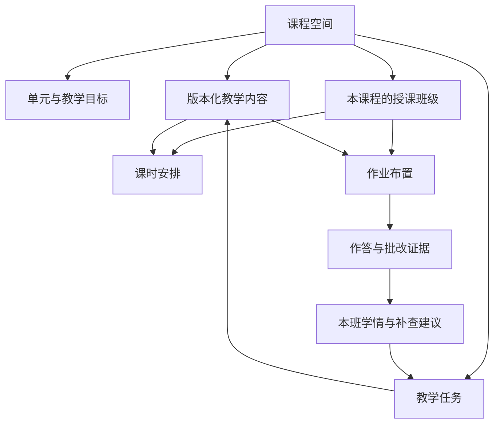

# Edu Agent 课程教学工作台设计草案

状态：待评审  
日期：2026-11-19  
适用范围：edu-harness 教师端重设计，以及与 coursemaker 的衔接

> **2026-11-21：首版范围已收窄为一个班、一节课的闭环，以 [LESSON_LOOP_DESIGN.md](LESSON_LOOP_DESIGN.md) 为准。** 本文的多班级、布置记录、课时安排、主题单元、单元讲评等内容作为后续阶段设计保留；对应代码仍在数据层，首版界面不显示。

本文提出一个以课程为长期工作空间、以班级为教学实施对象、以任务为日常入口的教师工作台。课时作为常用的教学安排和闭环查看单位，由系统随工作自动组织；教师无需为每一节课手动建立项目。

设计保留现有方案中的产物版本、来源引用、教师确认、作答证据和研究留痕。主要调整顶层组织方式、日常操作流程，以及内容复用和真实教学记录的关系。本文描述的是目标方案，不表示这些能力已经实现；评审通过后再据此拆分开发任务。

## 1 产品目标与首版范围

### 1.1 要解决的问题

教师通常围绕一门持续教授的课程开展工作：准备下一节课，把已有练习发给不同班级，处理刚收上来的作业，根据学生表现调整讲评。教材、课标、名单和教学进度具有连续性，不应该每节课重复输入。

当前以课时项目承载所有资料、学生名单和产物的方式，适合演示一条闭环，但会增加日常维护成本，也不容易表达同一内容用于多个班级、一次作业覆盖多个课时的情况。

新工作台的目标是：教师能从手头的真实任务直接开始，系统自动复用适用的背景、保存本次使用的依据，并把成果和反馈归入课程。

### 1.2 首版范围

首版对应第13节的阶段 A（可靠性底座）和阶段 B（课程工作台）：

- 统一确认规则、分析覆盖范围、运行写回前重新验证依据、操作幂等；
- 课程空间、班级与授课关系、任务首页、自动生成的课时记录；
- 一份内容用于多个班级，各班的布置、作答和学情相互独立；
- 旧课时项目映射到课程，历史产物ID和引用不变。

阶段 C（局部编辑、文件导出、coursemaker 对接、A/B 留痕补齐）和阶段 D（布置快照之上的复核队列、跨课时再练、研究整理与训练导出）在首版验收通过后实施。首版仍沿用现有的五阶段生成能力和研究导出，只调整它们的组织方式。

**学科范围。** 数据结构和流程不绑定学科：学科可从已有选项中选择，也可自行填写；学科差异通过课程背景、教师材料、题型和评分要求表达；没有匹配课标时依据教师材料工作，不能套用其他学科的标准。首版的验收重点与原始需求一致，放在**数学和人工智能**两个学科，以及备课和出题改题两类任务。其他已有学科包和自定义学科可以使用通用流程，但不作稳定性承诺；效果按学科分别报告，不以数学的结果代表其他学科。

可靠性按任务、题型和输入形式分别验证：确定性工具只处理适用的评分点，无法自动核验的内容交由模型辅助并由教师复核。

首版暂不扩展完整教务系统、自动排课、家校沟通、跨校协作和学生长期能力预测。学生在线领任务可在后续接入；首版仍可通过教师导入作答完成闭环。课件与视频生成复用 coursemaker，避免在两处维护相同生产流程。

### 1.3 与原始需求的关系

[原始需求](design.md)要求“以课程项目为单位保存工作”，示例是“高一数学｜对数函数｜第2课时”，五类任务都在这个项目里开展。现有实现按此做成了一个课时一个项目。本方案不再以课时项目作为顶层单位，**这一调整需要需求方确认**。

调整的理由：

- 连续上课时，每节课新建项目都要复制名单、背景和课标选择；“进入下一课时”只能复制，无法共享后续修订。
- 同一份练习用于两个班时，要么把两个班的作答混在一个项目里，要么复制出两套互不关联的产物版本。
- 一份周末作业覆盖多节课、一次讲评引出几项补查，这些关系放不进单个课时容器。

原始需求的其他要求在新结构中保留：

| 原始需求 | 本方案中的对应 |
|---|---|
| 课程背景／资料区＋五个任务入口＋各阶段成果记录 | 课程空间保存背景和资料；首页提供任务入口；按课时或按目标查看各阶段成果（第3、4节） |
| 传递有来源、经教师确认的产物 | 不变，沿用现有产物版本与引用 |
| 每一步有“接着做”按钮，并显示“已参考” | 保留在任务工作区（4.3） |
| 允许跳步，处理上游修改 | 直接批改现成试卷、直接准备讲解（5.4、5.5）；修改影响检查（6.3） |
| 没有作答时只输出“可能的易错点” | 不变（5.5、7.2） |
| A/B 嵌入正常工作 | 保留，完整规范拆为单独文档（第11节） |
| ELE 按明确任务整理案例，记录共同来源 | 区分任务、运行和研究案例，按来源组切分（见 A/B 与训练数据规范） |
| 聚焦一两个学科，先关注备课、出题改题 | 结构不限学科，首版验收集中在数学、人工智能和这两类任务（1.2） |

如果需求方希望保留“课时项目”这一说法，可以把课时安排作为界面上的主要查看方式，底层仍按本方案组织，不影响数据模型。

### 1.4 术语

- **课程空间**：一门课程在一个学期内的持续工作空间。
- **授课关系**：某个班级学习某门课程，承载本班进度和学情。
- **任务**：教师主动开始的一项教学工作，例如备课、出一份练习、批改一次作业。
- **运行**：任务中的一次模型生成或批改。重新生成、重试属于同一任务的不同运行。
- **布置记录**：某个班的一次作业，固定题目、评分标准版本和参与名单。
- **ELE（Education Last Exam）**：项目用于评测教育模型的案例集，按明确任务整理案例。
- **研究案例**：从一次任务整理出、可进入 ELE 或研究统计的记录；重试和内部调用不单独计数。

## 2 组织方式与核心概念

### 2.1 课程是长期空间

课程空间示例为“高一数学·上学期”，保存教材、课程标准、单元安排、教学目标和公共资料。教师建立一次后持续使用，可以归档，并在下一学期复用内容。

班级独立维护学生名单，通过授课关系关联课程。同一课程可以用于高一（3）班和高一（5）班；两个班共享教学内容，但拥有独立的授课进度、作业和学情。

单元或主题用于组织内容，例如“对数函数”。创建课程时不要求先填完整单元目录，可以从教材目录导入，也可以随工作逐步补充。

### 2.2 课时与任务的区别

课时安排表示某个班的一次计划或实际教学，例如“高一（3）班·对数不等式·第2课时”。日期可以暂缺，也允许一份教学设计分两次实施。

教学任务表示教师正在完成的工作，例如备课、制作练习、批改一份作业、准备讲评。一次任务可以关联多个目标、单元和课时，也可以暂时没有课时归属。

同一次任务中的重新生成、修改和候选比较，属于该任务的不同运行或产物版本。教师主动开始新的教学工作时，才建立新任务。

### 2.3 内容与使用记录分离

| 对象 | 示例 | 主要职责 |
|---|---|---|
| 课程空间 | 高一数学·上学期 | 持续保存公共背景和教学内容 |
| 班级与授课关系 | 高一（3）班学习本课程 | 管理名单、本班进度和数据边界 |
| 单元或主题 | 对数函数 | 组织跨课时内容 |
| 教学目标 | 能在解对数不等式时检查定义域 | 连接活动、题目和证据 |
| 教学任务 | 准备对数函数练习 | 保存本次需求、运行和成果 |
| 教学产物 | 教案第3版、试卷第2版 | 保存可复用且有版本的内容 |
| 课时安排 | 3班周三的讲评课 | 记录计划、实施状态和使用内容 |
| 作业布置记录 | 3班对数函数练习 | 固定本次题目、评分标准和参与名单 |
| 学习证据 | 某学生在某题的作答与判定 | 支持本班分析与后续教学 |



图中的课时和作业引用具体内容版本；课程公共资料可以持续修订，已经发生的教学记录保留当时依据。

## 3 教学闭环如何组织

备课、出题、批改、学情、讲评仍是系统支持的五类能力，但不要求教师按固定顺序操作。系统根据当前任务所需的材料提示补充内容。

闭环可以围绕一个课时展开，也可以围绕一个目标、一个单元或一次作业展开。例如一份周末作业覆盖三节课，周一的讲评又形成两项补查任务。这些对象通过来源和目标关联，不必被放进同一个课时容器。

系统提供两种查看方式：

- 按教学安排查看：这节课准备了什么、实际使用了什么、后续有哪些反馈。
- 按目标或任务查看：这个目标教过什么、测过什么、有哪些证据、接下来准备做什么。

没有批改或学情的课时也可以正常完成。生成讲评稿不代表已经讲评；第二次作答得分提高也不自动证明某种教学方法有效。

## 4 教师工作台与页面结构

### 4.1 首页

首页回答“现在接着做什么”，显示最近工作和需要教师处理的事项。

```text
我的教学

当前课程  高一数学·上学期       当前班级  高一（3）班

继续工作
  对数函数第2课时教案             继续修改
  对数不等式作业                  5份待复核
  第1轮讲评                      查看草稿

开始工作
  准备下一节课   出一份练习   批改作业   准备讲解
  上传或粘贴材料
```

数量和标题来自实际记录。当前班级是操作默认值，每次布置、导入作答和查看学情时仍显式展示班级，避免误用其他班的数据。

### 4.2 课程空间

课程内提供“教学安排、内容与资料、作业与讲评、班级学情”视图。公共内容视图允许不选班级；查看学生表现必须选择具体授课班级。

五阶段流程用于解释某次工作的关联成果和建议下一步，不作为所有页面共同的强制进度条。教师可从成果详情跳到相关原题、评分标准、学生作答或后续任务。

### 4.3 任务工作区

工作区包含本次需求、实际参考材料、产物编辑和运行状态。常用操作是继续编辑、修改指定部分、采用版本、导出，以及接着出题或准备讲评。

“已参考”可展开到具体来源片段。未进入模型、读取失败和被截断的材料分别标注。教师可以排除材料、指定章节或加入额外要求。

“修改第3题难度”“缩短导入活动”“补一道定义域练习”只更新相关部分。服务端仍保存完整的新版本，并展示修改差异；未修改的内容保持可追溯。

## 5 典型使用流程

### 5.1 第一次使用

教师只需输入课程名称和学科，即可开始备课；学科支持选择或自行填写，年级、教材、学期和班级按需要补充。可以上传已有教案或教材目录，不要求先完成整套课程规划。

首次布置作业或导入作答时，再关联班级和名单。系统记住已经填写的背景，之后以可编辑默认值提供。

### 5.2 准备下一节课

1. 教师在课程中点击“准备下一节课”。
2. 系统根据所选班级的进度建议主题、课次和已有资料，并展示可参考的已确认学情。
3. 教师可直接开始，也可调整主题、时长或教学要求。
4. 系统自动建立备课任务，生成可编辑教案。教案首次采用时才建立计划中的课时安排；只生成未采用的草稿不产生课时记录。
5. 教师采用后，可继续出题、导出教案，或送入 coursemaker 制作课件。

“下一节课”的内容和日期是建议，不自动认定上一节已经授课。班级进度由实际使用记录或教师调整决定。

计划中的课时不会自动变成“已授课”。计划日期过去后仍未标记的课时在首页集中提示，教师可标记已授课、改期或取消；没有日期的计划课时在本班之后的课时标记已授课时一并提示。取消的课时保留记录，不再出现在进度建议中。

### 5.3 一份内容用于两个班

教师完成一份教案后选择“用于其他班”，可以直接复用，也可以创建本班调整版。内容层记录派生关系，班级层保存各自采用的版本。

例如3班使用基础版，5班增加一道提升题。两班的学生作答分别归入各自的作业布置，不能因为题目相同就合并为一份学情。

### 5.4 带现成试卷直接批改

1. 教师点击“批改作业”，选择班级并上传试卷、答案和作答。
2. 系统解析题目与评分要点，教师核对后形成评分依据。
3. 系统自动建立本次作业记录，关联已经发生的作答；不要求补建教案。
4. 批改后集中处理待复核项，再生成本次作业分析。
5. 教师可从选中的问题准备讲评或补查任务。

从试卷反推的目标标记为“系统建议”，未经确认不纳入正式目标覆盖统计。首版保留文字、CSV和教师核对后的照片转写入口；整班试卷自动切题另行验收。

### 5.5 带一个疑问直接准备讲解

教师粘贴题目和问题即可生成讲解草稿，不必先生成学情分析。没有实际作答时，内容标为通用讲解或可能易错点；附有学生原文时，可围绕该份作答解释，但不扩大为全班结论。

### 5.6 单元讲评与后续再练

教师可以选择同一班级的多份作业准备单元讲评。系统显示每份作业的参与人数、完成情况、题目版本及未处理项，教师决定纳入范围。

再练题关联具体目标和问题模式。比较时只纳入确实接受相应再测的学生，并区分未再测、待复核和已获得新证据。不同难度、不同帮助条件的结果单独说明，不直接解释为能力增长。

## 6 教师确认与内容生命周期

### 6.1 内容状态与使用状态分开

| 维度 | 状态示例 | 含义 |
|---|---|---|
| 内容审阅 | 草稿、已采用、已被替代、已归档 | 教师是否接受这个内容版本 |
| 教学实施 | 计划中、已布置、已授课、已取消 | 是否发生过实际教学行为 |
| 作答处理 | 待收集、部分收到、待批改、待复核、已完成 | 本次作业的处理进度 |
| 模型运行 | 排队、运行、成功、失败、取消、输入已变化 | 一次生成或批改任务的执行情况 |

版本内容不可原地覆盖。已采用表示可以用于相应工作，不等同于完成独立正确性审定。批量采用只能覆盖符合规则的结果，未判定项不得通过通用确认接口绕过。

### 6.2 确认集中在重要节点

首版保留三类主要确认：使用前核对题目与评分标准，批改后处理风险项，形成教学判断前核对学情结论。低风险结果支持批量审阅和采用，风险项单独列出。

复核页面并排显示学生原文、题目、评分要求、系统判定和疑点。每次改判记录理由和变更内容，不要求教师重复填写系统已经知道的信息。

### 6.3 已使用内容的修改

公共内容更新不改写历史布置。未发布草稿可以选择更新；已布置的作业继续固定原版本，并提示新版可用于后续使用。

评分标准确需纠错时，教师选择“更正本次评分依据”，预览受影响的作答，明确启动重批。旧结果保留，新结果经确认后成为该次作业的有效成绩；相关分析同步标记需要更新。

评分标准属于课程层的共享内容，可能被多个班的布置记录固定使用。更正时在同一谱系建立新版本，只有发起更正的布置记录改为固定新版本；系统同时列出仍在使用旧版本的其他布置记录（例如5班的同一练习），教师逐个决定是否同样更正并重批，不自动波及其他班级。后续新建的布置默认使用新版本。

对于教案文字调整，系统可以建议不影响下游；答案、题干语义、分值和评分要求变化必须按实质修改处理。教师需要看到变化和影响范围，不能只收到一个过期标记。

## 7 上下文与证据规则

### 7.1 上下文的来源与优先级

上下文按任务组装：教师本次明确要求、已采用的任务产物、本班适用的学情、相关课程资料。出现冲突时展示冲突并请求必要选择，不静默拼接相互矛盾的要求。

批改只能读取本次固定的题目、评分标准及对应作答。学生过去的表现不能影响本次给分。班级分析读取明确范围内的有效批改；课程公共背景不自动包含任何班级的学生原文。

“本班适用的学情”取代现有的 `carryover` 快照，规则如下：

- 只读取同一授课关系下、教师已确认的分析结论和问题模式，不读取其他班级；
- 默认取本班最近一次已确认的分析，以及其中仍未处理的问题模式；教师可以在“已参考”中增减；
- 任务开始生成时固定所用的分析版本，写入运行的输入清单；之后的分析修订不改变这次结果，只提示有新版本可用；
- 部分分析（7.3）可以被读取，但“已参考”中标明样本范围，模型输入中同样注明。

长材料按章节和片段组织，记录文档版本、页码或位置、实际发送片段及截断情况。首版可先做教师选章节和简单检索，不要求先建设复杂知识图谱。

### 7.2 学情表达

学情分为可核验事实、待验证解释和补查建议。例如“12份作答未写定义域”是事实，“可能没有理解定义域”是解释，“请说明真数为什么必须大于零”是补查任务。

同一错误标签只支持相同标签的失分统计，不能直接证明所有学生具有相同认知原因。概述和问题模式执行同样的证据要求；丢弃无效模式时，不得保留与其矛盾或同样无依据的概述。

### 7.3 分析覆盖范围

完整分析要求本次纳入的当前作答都有有效、已确认的判定，并且没有未处理的依据变化。名单、收到作答、有效批改和待复核人数分别显示。

允许教师主动生成部分分析，但必须标明样本范围和未处理数量，不能标记为全班最终结论。后续新增作答时保留原分析快照，并提示存在新数据。

### 7.4 跨课时目标与证据

目标使用稳定标识，其描述可以版本化。题目与评分点关联目标；目标发生实质变化时重新检查映射。系统先展示近期证据，不默认计算单一掌握分数。

证据应记录是否接受帮助、判定来源和时间。导入作答无法确定帮助条件时记为“未知”，不视为独立完成。无数据、未再测、帮助下完成、独立完成和结论冲突分别呈现。

### 7.5 工具的判定边界

数值工具仅在最终答案明确时核验数值；代数核验明确变量和适用条件；化学配平只能证明守恒，不能替代反应身份与反应条件判断。工具只覆盖对应评分点，无法确定时转模型或教师。

模型引用学生原文是来源核验，不是正确性的证明。按学科、题型和风险对得分与失分结果安排复核或抽检，并通过评测调整规则。

## 8 版本一致性与运行恢复

每次运行建立输入清单，固定产物版本、材料片段、提示词版本和模型配置。耗时模型调用在数据库写事务之外进行，写回时重新验证依赖。

如果输入在运行期间被实质修改，结果保存为“基于旧依据”，不得自动成为当前有效结果。教师可以查看，或以新依据重新运行。只修改无关内容时，不应阻塞本次结果。

每次操作带幂等标识，相同操作重试返回同一运行记录。批量批改按作答保存进度，失败后只重试失败或未完成的单元。取消后禁止迟到结果被自动采用；后台恢复必须识别已经提交的结果，避免重复生成和重复计入研究记录。

首版可继续使用SQLite和单机任务执行器，但需要持久化运行与进度。课程组织改造不依赖先迁移数据库或引入多个智能体。

## 9 产物交付与 coursemaker 衔接

### 9.1 教师交付物

教师交付文件在阶段 C 实现，优先提供可编辑教案、学生版练习、教师答案与评分标准、讲评提纲，以及可打印PDF。公式、题号、分页和学生版不泄露答案列入验收。导出失败要明确提示，不能以研究JSON替代教师文档。

本地采用内容与对外发布是不同操作。首次对外发布明确展示目标班级、内容版本和实际影响。学生端尚未接入时，可记录“已线下布置”，但不显示已自动发送。

### 9.2 与 coursemaker 的职责分工

edu-harness 管理目标、教案、题目、评分、证据和版本关系；coursemaker 负责讲义、课件和视频的制作与呈现。首个集成范围是将已采用的教案和题目送入课件生成，不同时接入所有五阶段。

交换包至少包含契约版本、课程和课时标识、源产物版本与哈希、教学目标、活动、题目、受众版本、允许使用的素材及呈现要求。学生原文默认不随公共课件输出，需使用典型错解时采用经过处理的内容。

返回结果保存为派生产物，记录来源包与运行标识。上游变化后提示具体影响，先支持教师选择重新生成受影响部分。双方通过稳定标识映射对象，避免仅凭课程标题匹配，也避免维护两套互不关联的内容版本。

## 10 数据模型与接口边界

以下为概念模型，具体表结构在实施阶段确定。

| 实体 | 关键字段或关系 |
|---|---|
| Course | 学科、学期、教材、所有者、归档状态 |
| ClassGroup 与 Enrollment | 班级、稳定学生标识、成员有效期 |
| CourseOffering | 课程与班级的授课关系、本班进度 |
| Unit 与 Objective | 课程归属、顺序、目标稳定标识和版本 |
| Task | 任务类型、需求、课程归属、可选班级及课时关联 |
| LessonSession | 授课关系、计划时间、实际使用状态、固定内容版本 |
| AssignmentInstance | 授课关系、题目与评分版本、参与名单快照 |
| Material 与 SourceGroup | 原材料、版本、片段、同源与派生关系 |
| Artifact 与 ArtifactRef | 产物谱系、版本、采用状态、上游依赖 |
| Submission 与 Grading | 布置记录、学生、作答版本、判定及评分依据 |
| Analysis 与 EvidenceLink | 分析范围、覆盖人数、事实及引用证据 |
| Run 与 RunItem | 输入快照、幂等键、执行状态、进度、费用与错误 |
| ReviewEvent 与 ResearchCase | 教师操作、任务归属、独立审定状态 |

A/B 比较、反馈、训练授权和数据集导出相关的实体（Comparison、Candidate、FeedbackEvent、Adoption、TrainingConsent、DatasetExport）见[A/B 候选与训练数据规范](AB_AND_TRAINING_DATA.md)第7节，首版不新增这些表。

首版课时、班级关联可为空，使教师先备课或整理资料。作答与批改则必须归属具体布置记录。任务与课时采用关联关系，允许一项任务覆盖多课时。

### 10.1 产物归属（建议）

现有的 `artifacts` 及其他表都以 `project_id NOT NULL` 归属课时项目。建议继续使用一张 `artifacts` 表和现有的谱系、版本、引用及过期传递机制，按产物类型区分归属，不另建作答和批改表：

| 产物类型 | 归属 | 说明 |
|---|---|---|
| `lesson_plan`、`question`、`rubric` | 课程（`course_id` 必填） | 可复用的教学内容，可被多个班的课时和布置记录引用；本班调整版是同一课程下的派生谱系 |
| `submission`、`grading` | 布置记录（`assignment_id` 必填） | 一份作答只属于一次布置，批改只读这次固定的题目和评分标准版本 |
| `analysis`、`problem_pattern`、`comparison` | 布置记录，或同一授课关系下的多份布置 | 跨布置的单元讲评分析记录纳入的布置清单，不能跨授课关系 |
| `review_plan` | 布置记录 | 讲评稿依据本班学情，典型错误引用本班学生原文，因此不作为课程公共内容；需要复用时另存为不含学生原文的讲解 |

不属于任何班级的作答（`assignment_id` 为空，例如旧项目或没有选班级时的临时批改）仍按原有规则处理：跟随最新确认的题目和评分标准，上游实质修改后标记重批。这是过渡行为，只有班级布置固定版本。

所有产物增加可空的 `task_id`，记录由哪项任务产生。原 `project_id` 保留为旧数据来源，新产物不再依赖它。`learners` 改为归属班级，旧项目内的学生代号经教师确认后映射到班级成员。

`grading` 等计算结果的过期传递规则不变，但只在同一布置记录内传递；课程层内容的实质修改只标记仍处于草稿或未布置状态的下游，已布置的记录按6.3处理。

### 10.2 再练轮次

现有的 `round` 字段在新模型中由布置记录表达：讲评后再练是同一授课关系下的一次新布置，记录 `parent_assignment_id`（来源布置）和针对的问题模式谱系，轮次由这条链计算得出，不再单独存字段。两轮对比只读取这两次布置都有有效判定的学生（5.6）。迁移时，旧项目中各轮次的产物分别映射为一条布置记录，并按原轮次顺序建立父子关系。

领域层集中提供开始任务、采用产物、创建布置、批改、检查分析条件、创建下一课时和校验运行输入等能力。API与界面共同读取领域层返回的状态及原因，不各自实现一套流程条件。

课程归属不等于访问授权。接入多人网站前，服务端必须校验用户对课程、班级和学生记录的访问权限；不能仅相信前端传入的课程或班级ID。本地单人模式可以保留，但不直接作为公网多人部署方案。

## 11 A/B 候选与训练数据

A/B 比较、教师反馈留痕、研究整理和训练导出的完整规范见[A/B 候选与训练数据规范](AB_AND_TRAINING_DATA.md)。工作台设计只依赖其中三条约束：

- 两份候选针对同一份冻结的任务输入生成，界面隐藏模型名称，A/B位置随机且在本次比较中固定。
- “选哪份继续工作”和“明确认为哪份更好”分开记录；“两份都可用”“都不合适”“跳过”各自保留，不强行分出胜负。
- 编辑和融合建立新版本，原候选不被覆盖；最终采用版本和实际使用记录可分别还原。

首版不提供训练导出，学生原文不进入训练数据。紧急批改和风险复核不插入比较。

## 12 现有系统的迁移方案

保留 `edu_core` 的版本化产物、引用关系、模型适配和逐点评分能力。将当前 `project` 逐步降为旧任务工作区，通过映射接入课程，不直接重写已有记录。

| 当前结构 | 改造方向 |
|---|---|
| 每个课时一个project | 增加课程空间，旧project映射为任务容器及可选课时 |
| project内的学生名单 | 建立班级与成员关系，历史名单保留来源 |
| 新课时复制背景和名单 | 引用公共资料和授课关系，冻结实际使用的证据版本 |
| 五阶段固定导航 | 首页任务入口，五阶段作为任务关联视图 |
| generation承担多种计数 | 区分Task、Run、内部调用和ResearchCase |
| 仅用当前状态判断下一步 | 领域层统一检查前置条件、版本和覆盖范围 |
| 项目JSON导出 | 保留研究导出，新增教师交付文件 |

迁移采用新增结构与旧数据映射并行的方式：先备份并提供迁移预览，再执行可重复的迁移。历史产物ID和引用不改变，旧项目仍可读取。

不能按相同学生代号自动合并身份，也不能仅凭相同标题自动合并课程。系统提出候选映射，由教师确认；无法判断的旧项目放入“待整理”，仍可查看。迁移完成后校验产物数量、引用完整性和历史成绩，回滚依赖备份及迁移映射恢复。

## 13 分期实施与验收

| 阶段 | 是否首版 | 交付范围 | 验收重点 |
|---|---|---|---|
| A 可靠性底座 | 首版 | 工具边界、统一确认、分析覆盖、版本写回复验、任务幂等 | 错误答案不被工具无条件放行；旧依据结果不自动生效；无证据概述不能进入后续教学 |
| B 课程工作台 | 首版 | 课程、班级与授课关系、主题、任务首页、自动课时记录、布置记录与版本固定、产物归属调整、迁移映射 | 连续准备三节课无需重复建立课程项目；两个班复用内容且数据分离；旧项目迁移后产物与成绩一致 |
| C 备课与出题交付 | 后续 | 局部编辑、资料选择、A/B留痕补齐、学生与教师版本、文件导出、最小coursemaker对接 | 教师能拿自己的材料产出可修改、可打印、可授课的成果 |
| D 作业闭环与研究整理 | 后续 | 复核队列、跨布置单元讲评、跨课时再练、来源分组、独立审定与训练数据导出 | 跨课时闭环可追溯；覆盖范围明确；重试和内部调用不膨胀案例数 |

布置记录和版本固定从原阶段 D 提前到阶段 B：两个班复用同一内容、数据分开，必须依赖它。

旧功能可继续存在，但新入口仅对完成相应验收的能力作稳定性承诺。验收重点放在数学和人工智能（1.2），其他学科可以使用通用流程，分别记录效果；多人协作后续扩展。

### 13.1 必须通过的场景

首版（阶段 A、B）：

1. 数学和人工智能教师第一次只填课程和学科，即可上传材料开始备课；填写未预置学科时也能进入通用流程。
2. “准备下一节课”自动继承公共背景，正确使用所选班级的进度和学情；只生成草稿不产生课时记录。
3. 同一练习用于两个班，分别产生布置记录，修改公共新版不改变已布置内容。
4. 教师从现成试卷直接进入批改，从单个问题直接进入讲解。
5. 批改期间修改评分依据，旧结果可追溯但不会被默认为有效新结果；3班更正评分标准时，5班的布置不被自动改动，但会被列出供教师决定。
6. 部分批改生成部分分析，页面明确显示覆盖范围，完整分析不允许绕过待复核项。
7. 没有证据的概述不能因自由文本字段绕过验证，也不能自动继承到下一课时。
8. 重复提交、关闭页面、任务失败后恢复，不产生重复布置或重复有效成绩。
9. 材料未读取或被截断时如实展示，所有“已参考”片段可定位。
10. 旧课时项目迁移后，产物ID、引用、各轮次和历史成绩不变；未确认映射的项目留在“待整理”且可查看。

后续阶段：

11. 作业覆盖多个课时，讲评仍能找到各题的目标、作答和评分版本（D）。
12. 导出学生卷不含答案；教师版含正确对应的答案、评分标准与版本（C）。
13. A/B、反馈留痕、来源分组和训练导出的场景见[A/B 候选与训练数据规范](AB_AND_TRAINING_DATA.md)第11节（C、D）。

### 13.2 教师试用

上面五项指标不需要老师事后填表：`GET /api/trial/report`（后台管理，只对管理员开放）从任务、产物确认事件、运行、布置记录和课时记录推导。两个会决定所有数字的定义写在 `edu_core/workflow/trial.py` 的开头：**可用成果**是任务里第一份被确认的产物（等待、审核和修改都计入耗时）；**实际用于教学**是教案被课时采用且该课时标记已授课、题目被布置且收到作答。意愿用 `POST /api/trial/feedback` 记录，每位老师以最后一次回答为准。重复录入只有代理指标（课时信息再次填写、名单再次录入、手工勾选课标），系统无法判断是否真的重复；老师原有方式的耗时和试用结论仍需要人来采集。

建议先邀请3至5位数学和人工智能教师，各自用真实材料完成连续几次教学工作（至少连续三节课的备课和一次作业批改），并覆盖客观题、开放性作答等不同评价方式。其他学科教师可以参与，结果单独报告。记录从开始到可使用成果的总耗时、审核与修改耗时、重复输入次数、产物采用情况，以及是否愿意继续使用。

以下为成功标准的建议初值，需在试用开始前由项目组确认，确认后不再根据结果调整：

| 指标 | 建议初值 |
|---|---|
| 连续三节课中，课程背景、名单和课标选择的重复录入 | 0次（首次填写之外） |
| 两个班复用同一份练习时的串班错误（作答、成绩或学情归错班） | 0次 |
| 教案和题目经教师修改后实际用于教学的比例 | 不低于一半 |
| 从开始到得到可用成果的总耗时（含等待、审核、修正） | 不超过教师原有方式 |
| 试用结束后表示愿意继续使用的教师 | 过半数 |

与教师原有工作方式比较时，把等待、审核、修正和导出时间全部计入。教学效果另行评估，不能用生成速度或使用满意度替代。试用前确定成功标准，避免观察结果后再调整口径。

### 13.3 实施状态（2026-11-19）

阶段 A、B 已有首版实现，实现细节见[开发参考](DEVELOPER_REFERENCE.md)第3节和第5节。13.1 的首版场景 1–10 由 `tests/test_edu_course.py`、`tests/test_edu_workflow.py` 和 `tests/test_edu_api.py` 覆盖，并用假模型做过浏览器走查；尚未有真实教师试用。2026-11-20 用真实模型（DeepSeek-V4.1-Flash 主判与生成、qwen3.8-flash 复核）跑过一次 `scripts/edu_smoke_course.py`：两个班共用内容、部分与完整分析、更正评分依据、本班学情进入下一课时、再练对比，19 项检查全部通过（`reports/edu/smoke-course-2026-11-20.log`）。

已实现：

- 课程、班级与成员、授课关系、任务、课时安排；教案首次采用时建立计划中的课时，过期未标记的课时在首页提示；“准备下一节课”只给建议。
- 布置记录：固定题目和评分标准版本、名单快照；两个班共用内容、作答和学情分开；新版可用提示与改用新版本；更正本次评分依据只作用于本次布置，并列出其他使用同一版本的布置。
- 本班学情取代 `carryover`（7.1）；分析覆盖范围与部分分析（7.3）；问题模式没有全部通过证据核对时，概述改为服务器写出的事实陈述（7.2）；只有已确认的分析才传给下一课时。
- 统一确认规则、写回前复验、批改逐份保存、请求幂等（第8节）；“已参考”标出截断和未发送的材料（4.3）。
- 自定义学科使用通用流程；课程资料各班共用。
- 旧项目整理：候选分组、教师确认、整理前备份、提交前核对数量。
- 主题（2.1）：开始工作时按知识模块归入同名主题，主题随工作逐步补充，可改名、可调整任务归属；按主题查看（第3节）：教学目标、各班课时与布置、已确认分析中的目标达成与问题模式、进行中的工作，不合成单一掌握分数（7.4）。
- 不经学情直接准备讲解（5.5）：没有作答时为通用讲解和预判的易错点；附一名学生作答时只评这一份，引用必须能在作答中逐字找到。
- 本班调整版（5.3）：从已采用的教案和题目复制出另一个班的任务，副本是新谱系的草稿，记录来源（`edit_of`、`derived_from`），原任务不受影响；也可以直接把同一教案加入其他班的课时。
- 教师在备课页勾选本班学情的条目和概述（7.1），取消勾选的不发给模型，仍列出可以勾回。
- 工具判定边界（7.5）：数值核对只在最后一句的最后一个数值是期望值时判对；化学方程式未配平判错，配平且物质与参考方程式一致才判对，配平但物质不同或没有参考方程式时交给模型；反应条件不由工具判断。

阶段 C、D 与多人账号（2026-11-19 第二轮）：

- 课程目标（7.4）：备课方案确认时，其中的目标对应到课程目标（同一方案的新版本沿用、同样表述复用、否则新建）；表述变化记录描述版本并提示核对题目对应；老师可以改对应关系；按目标查看各班、各次布置的证据，导入的作答帮助条件记为“未知”。
- 跨布置的单元讲评（5.6）：先预览所选作业的参与、有效批改、未处理项和题目版本，再生成一份讲评稿，记录纳入了哪些布置；不能跨班。
- 运行与研究计数（第8、12节）：老师发起的每次模型操作是一次运行，其中的所有模型调用（含并行的自检、盲审）记录运行编号；研究导出分别统计老师任务、运行、模型调用、产物版本、研究案例和来源组，未启用账号时不统计贡献者。
- 局部修改（4.3）：备课方案按目标、活动、重点、难点或备注只改一部分，其余保持不变，保存完整新版本并记录改了什么和修改要求。
- 资料选择（4.3）：每项任务可以排除材料、为材料指定章节或关键词，只发送对应部分并记录位置；“已参考”标出排除和只发送章节的材料。
- A/B 留痕（A/B 规范 2–5）：记录共同输入的哈希、展示位置映射、触发方式、抽样比例和规则版本；采用、明确偏好、两份都可用、都不合适、跳过分别记录；可以撤回改选、结合两份修改；重复或失败的替代版本不展示比较；抽样逐题进行，不设每日上限。
- 教师文件（9.1）：教案、学生练习（不含答案）、教师答案与评分标准、讲评提纲，提供打印版（浏览器另存 PDF）和 Word；只用已确认版本，没有时明确提示。
- coursemaker 交换包（9.2）：已确认的教案和题目连同版本、哈希、目标、受众和可用材料打包，不含名单和学生作答，附 coursemaker 课时结构；回传的课件记为派生产物，上游实质修改后提示。
- 来源分组、研究案例与独立审定（11.8）：来源组按引用、编辑、谱系、材料家族联通；研究案例按任务阶段整理；审定人不能是产出者，分歧需复议；开发集和测试集按来源组冻结，测试集案例不能用于调整。
- 训练授权与导出（11.6、11.9）：按课程授权；示范、明确偏好和带老师指令的修改三类数据；含学生原文的输入一律排除并按原因计数；撤回授权后停止导出并标记已导出的数据集。
- 多人账号（第10节最后一段）：`EDU_AUTH=1` 时需要登录；服务端对每个请求在路径、查询参数和请求体中出现的记录逐一检查权限；课程成员可访问课程内的一切，个人项目和班级归创建人，旧数据只有管理员可见。

仍未实现或有限制：

- 文件导出不依赖第三方库：Word 为基本排版，PDF 通过浏览器打印生成；公式按文字输出。
- coursemaker 一侧尚未接入：本系统只生成交换包和接收回传记录，没有修改 coursemaker 代码。
- 训练导出没有对老师材料做自动去标识，导出清单中注明需人工抽查；核验数据（批改、学情）因含学生原文全部排除。
- 账号为访问码登录，没有密码找回、单点登录和审计界面；只在受信任网络中使用，公网部署仍需前置 HTTPS 和更完整的鉴权。
- 阶段 C、D 与账号的功能只用假模型测试和浏览器走查过；真实模型冒烟只覆盖阶段 A、B 的主流程。都没有真实教师的使用记录。

## 14 本轮评审要确定的事项

| 事项 | 草案建议 |
|---|---|
| 顶层工作单位 | 一门课程在一个学期的持续教学空间 |
| 班级与内容关系 | 公共内容复用，本班进度、使用记录和学情独立 |
| 课时定位 | 自动组织的教学安排，可查看闭环，不是强制建项目入口 |
| 教师主要入口 | 从备课、练习、批改、讲解和最近工作开始 |
| 偏离原始需求 | 不再以课时项目为顶层单位，需需求方确认（1.3） |
| 首版范围 | 阶段 A、B：可靠性底座和课程工作台；C、D 在首版验收后实施 |
| 学科范围 | 结构不限学科；首版验收集中在数学、人工智能及备课、出题改题 |
| 与coursemaker的边界 | 本系统管理教学依据和反馈，对方生成课件与视频 |
| A/B与训练回流 | 拆为单独规范；首版只保证同条件比较、工作选择与明确偏好分开；首版不做训练导出，学生原文不进入训练数据 |
| 产物归属 | 一张产物表，教学内容归课程，作答与批改归布置记录，再练用布置链表达（10.1、10.2） |
| 首版成功标准 | 教师连续使用时减少整理与重复输入，产物可用且依据可查 |

优先评审第1.3节的需求偏离和第2至第6节中的组织方式与教师流程。产品方向确定后，再细化数据表、接口契约、页面设计和开发任务。

## 15 相关文档

- [原始需求文本](design.md)
- [A/B 候选与训练数据规范](AB_AND_TRAINING_DATA.md)
- [原教师端设计](TEACHER_AGENT_DESIGN.md)
- [当前开发参考](DEVELOPER_REFERENCE.md)
- [当前教师端使用说明](TEACHER_AGENT_GUIDE.md)

本草案评审通过后，应统一更新上述文档中的课程、课时、项目、确认和研究案例术语。
