# OmniEdu Harness 功能说明与测试记录（v0.10）

测试日期：2026 年 11 月 15 日（北京时间）。被测代码是当前工作区的 v0.10（新网页界面、逐路由权限、WAL 存储）。

测试日期补充：提示阶梯与讲解的修复和复测在 2026 年 11 月 15 日完成。

本文回答两个问题：系统现在能做什么；每项功能验证到了什么程度。v0.9（Gradio 界面）时期的验收记录已归档到 [archive/FEATURES_AND_TESTS-v0.9.md](archive/FEATURES_AND_TESTS-v0.9.md)。

## 1. 结论

**主要流程在真实模型和真实浏览器中都能走通。** 首轮验收发现的两个问题（连续提示会转给老师、完整讲解常常不给结果）已经修复，修复效果用多次重复的真实模型评测确认过（[第 5 节](#5-提示阶梯与完整讲解的修复)）。

| 测试层次 | 结果 | 能说明什么 |
| --- | --- | --- |
| 自动化测试（假模型、临时数据库） | **174/174 通过** | 状态机、评分聚合、权限、幂等、回滚、并发、证据失效传播等逻辑符合断言 |
| 真实模型脚本回归 | **8/8 通过** | OmniEdu-9B 和 Qwen3.5-27B 能走通所列场景 |
| 真实模型 + 浏览器功能验收 | **16/16 通过**，无页面脚本错误（修复前为 15/16） | 实际点击、上传、跳转，并与服务端状态核对 |
| 提示阶梯与讲解评测（真实模型，4 道题 × 4 次） | 三级提示 **16/16** 走完，0 次转老师；数值题讲解 **12/12** 给出结果；提示泄露答案 0 次 | 修复前：三级提示 0/12 走完，讲解 2/9 给出结果 |
| 班级模式登录（浏览器） | **通过** | 访问码登录、角色限制、身份锁定 |
| 存储性能（3000 会话、56MB 库） | 单次操作 2ms；40 个并发作答全部成功，峰值内存 137MB | 改造后的存储不随库大小复制数据 |

仍需关注：

1. **开启复核时，第二级提示大约一半到三分之二是服务器模板**（模型写的被复核否决）。模板能保证阶梯走完，但不如模型写的具体。
2. **只用 9B、不开复核时，解释类题目的提示可能直接给出结论。** 程序能拦下“替学生做计算”和“写出最终数值”，但拦不住概念题的完整解释，这只能靠复核模型。正式使用建议开启交叉复核。

所有结果来自脚本输入和模型输出，**不是教师评审或学生学习效果的证据**。

## 2. 测试环境与证据

- 主模型 `omniedu-9b`（vLLM，`http://127.0.0.1:8000/v1`）；复核模型 `qwen3.5-27b`（`http://127.0.0.1:8002/v1`），浏览器验收时开启了交叉复核。
- 默认教学策略 `open-task-policy-v4`；真实模型回归中另有一条 v5 用例。
- 浏览器：Chromium（Playwright），桌面 `1440 × 960`，手机 `390 × 844`。
- 隔离：验收服务运行在 7861 端口，使用临时数据库，没有写入正式学习库 `data/learning.sqlite`。
- 截图都来自真实浏览器；学生和班级是验收用的测试数据，模型输出按原样保留。

原始证据（`reports/functional-audit-v010/`）：

| 文件 | 内容 |
| --- | --- |
| [unit-tests.log](../reports/functional-audit-v010/unit-tests.log)、[unit-tests.xml](../reports/functional-audit-v010/unit-tests.xml) | 自动化测试输出与 JUnit 报告 |
| [teaching_v071_e2e.json](../reports/functional-audit-v010/teaching_v071_e2e.json)、[teaching_v08_e2e.json](../reports/functional-audit-v010/teaching_v08_e2e.json) | 真实模型脚本回归 |
| [browser-workflows.json](../reports/functional-audit-v010/browser-workflows.json) | 最终一次浏览器验收（修复后，16/16）：每一步的实际观察值 |
| [browser-workflows-before-hint-fix.json](../reports/functional-audit-v010/browser-workflows-before-hint-fix.json)、[browser-workflows-before-label-fix.json](../reports/functional-audit-v010/browser-workflows-before-label-fix.json) | 修复前的两次完整运行（都是 15/16，提示阶梯那一项失败），原始截图为 [hint-ladder-before-hint-fix.png](../reports/functional-audit-v010/hint-ladder-before-hint-fix.png) |
| [reports/hint-ladder/](../reports/hint-ladder/) | 提示阶梯与讲解的重复评测：修复前（`before.json`、`before-diagnosis.json`）、迭代过程中的几次（`after*.json`）、最终两种配置（`final-with-reviewer.json`、`final-tutor-only.json`），每一轮都保存了否决理由和草稿 |
| [browser-workflows-run-with-script-errors.json](../reports/functional-audit-v010/browser-workflows-run-with-script-errors.json) | 第一次运行：验收脚本自身的等待逻辑有错，7 项失败是脚本问题；保留它是因为其中记录了讲解未给出结果的输出 |
| [classroom-login.json](../reports/functional-audit-v010/classroom-login.json) | 班级模式登录检查 |
| [bench-storage.txt](../reports/functional-audit-v010/bench-storage.txt) | 存储性能测量 |

## 3. 功能总览

### 学生端（`/student/`）

| 功能 | 当前行为 | 本次验证 |
| --- | --- | --- |
| 身份 | 本地演示：首次填写名字和班级；班级模式：由访问码决定，不能修改 | 两种模式都在浏览器中操作 |
| 老师布置的任务 | 左侧列出本人的任务，显示状态和截止时间 | 真实页面领取并开始 |
| 自己提问 | 任何学科；可附题目照片、文字材料、.txt/.md/文字版 PDF | 上传两页 PDF 创建学习任务 |
| 作答与追问 | 提交后指出问题并追问；回答追问默认算对话，勾选“完整解答”才判定 | 真实错误作答；追问回复有自动化测试 |
| 分级提示 | 概念 → 步骤 → 换数据的例子；模型的提示被否决时，用对应级别的服务器模板 | 真实操作走完三级；另有 32 次重复评测 |
| 完整讲解 | 请求前先确认（之后做对记为辅助完成）；老师可以关闭；讲解以“最终答案”结尾 | 真实操作；另有 32 次重复评测 |
| 拍照作答 | 先显示识别文字供修改，确认后才判定 | 打印体测试图片 |
| 独立检查 | 练习完成后做一道没见过的新题；检查中没有提示和讲解按钮，接口也拒绝 | 使用老师题库中的检查题 |
| 学习路径 | 输入老师给的路径编号，查看按证据推荐的下一步 | 真实操作 |
| 会话保存 | 刷新后自动回到原会话；可用会话编号在别的设备恢复 | 脚本化检查 |

### 教师端（`/teacher/`）

| 功能 | 当前行为 | 本次验证 |
| --- | --- | --- |
| 班级选择 | 右上角输入或选择；列出已有班级；只有一个班级时自动选中 | 浏览器中操作 |
| 班级学情 | 四项指标、按学习目标的状态（需要帮助的排在前面）、分组补救建议、待复核队列 | 本次真实作答产生的数据 |
| 创建练习 | 题目、评分要求、参考答案、独立检查要求；分项评分、代数验证、检查题库、材料导入、知识点推荐；表单自动保存草稿 | 页面发布检查题和练习，并把检查题加入题库 |
| 批量出题 | 列出学习目标由模型起草；逐题编辑（编辑会取消“已核对”）；保存为新版本；审核后发布并分发 | 真实模型起草，页面审核发布 |
| 学习安排 | 从本班练习中选择，按名单布置补救、复习或诊断；延期或撤销；发布学习顺序 | 页面布置和发布 |
| 作答复核 | 题目快照、学生作答、原始照片、判定依据、分项结果、参考答案、当时的反馈、教学轨迹与策略回放；确认或改判 | 页面查看回放并改判 |

### 执行保障

| 机制 | 当前行为与依据 |
| --- | --- |
| 判定必须有证据 | 模型判定要引用学生原文，服务器核对引用；引不出或没把握转老师。自动化测试 |
| 工具优先 | 代数、数值、单位等确定性检查优先于模型；局部正确不能覆盖整题要求。自动化测试 |
| 回复审核 | 泄露答案、事实错误、冒充系统、语言不符的回复被拦下，重写一次，仍不合格用兜底句或模板。提示另有程序检查：不得写出最终数值，不得用题目里的数字替学生列式计算；讲解必须出现最终答案。真实验收中多次触发 |
| 区分学习证据 | 练习完成、辅助完成、模型评估的独立检查、工具验证的独立检查分开记录。真实验收 |
| 策略回放 | 每一轮的教学决定可以不调用模型重新算出。真实验收 |
| 改判连带失效 | 依赖关系记在 `evidence_dependencies` 表中，改判时沿依赖传播。自动化测试 + 真实验收 |
| 幂等与版本冲突 | 同一 `request_id` 重复提交返回同一结果；旧版本提交返回 409。自动化测试 |
| 并发 | WAL 读快照中计算，调用模型时不持锁；快照过期时重算并复用模型结果。自动化测试 + 性能测量 |
| 权限 | 每个 `/api` 路由都显式检查账号、班级和角色；测试会检查有没有遗漏的路由。自动化测试 + 浏览器 |

## 4. 真实模型浏览器验收

以下“通过”指该步骤的断言成立，不代表所有题型或教学质量都已验证。验收脚本：[scripts/capture_functional_audit.py](../scripts/capture_functional_audit.py)。

### 4.1 教师发布练习并布置给学生

教师在“创建练习”页先发布一道检查题（小红步行 4 小时行 20 千米），再发布正式练习（小明骑车 3 小时行 45 千米）。正式练习的独立检查要求写的是“能在新的情境中用路程除以时间求速度，并写出单位”，题库里勾选了那道检查题。练习列表接口返回 2 条记录，其中都不含参考答案。

结果：**通过**。

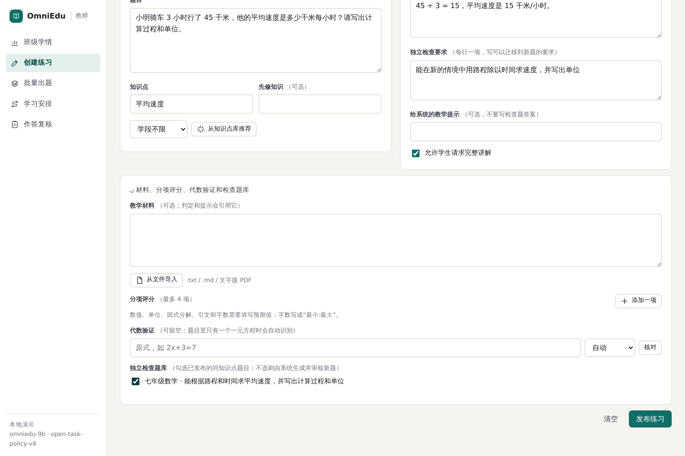

随后在“学习安排”中，把正式练习按名单布置给三名验收学生，“已布置的任务”表中出现 3 条记录。结果：**通过**。

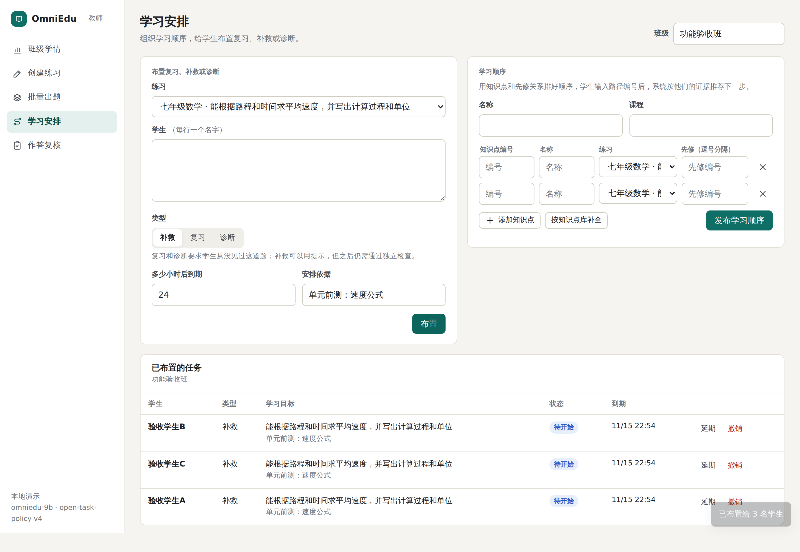

### 4.2 领取任务、答错、请求讲解、辅助完成

学生领取任务后，会话关联到对应的跟进任务，学生端拿到的任务数据中没有参考答案。结果：**通过**。

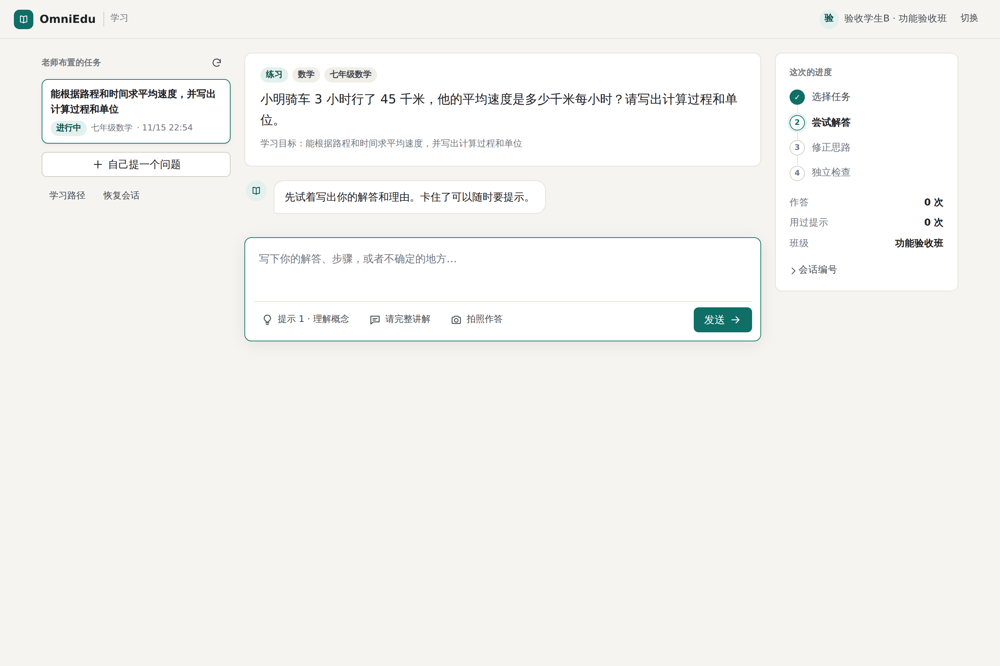

提交错误作答 `平均速度等于路程乘以时间，45 × 3 = 135……`，判定为有错，策略动作是定位问题（`locate`）。最终一次运行中，学生收到的是模型生成的回复：

> 平均速度表示每小时行多少千米，也就是把总路程按时间平均分。你算出的135比总路程45还大，这合理吗？

另几次运行中，模型的候选回复没有通过审核，学生收到的是服务器的引用模板：“先只检查这一处：「平均速度等于路程乘以时间，45 × 3 = 135」。把这一步得到的结果代回题目……”（最终一次运行就是这种情况）。两种情况都没有给出答案。结果：**通过**。

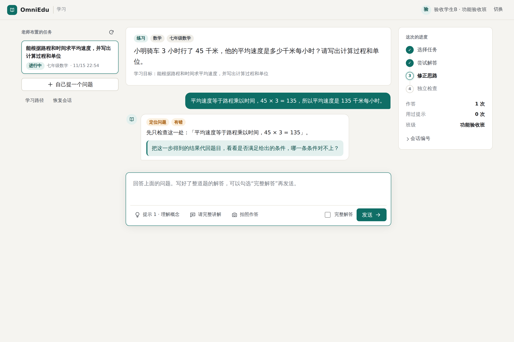

请求完整讲解（页面先弹出确认）。修复后的讲解是：

> 平均速度的计算公式是速度等于路程除以时间。题目中给出的路程是 45 千米，时间是 3 小时。将数值代入公式计算：45 ÷ 3 = 15。因此，平均速度是 15 千米每小时。
> 最终答案：15 千米/小时
> 接下来做一道新题，检查自己能否独立完成。

修复前，三次运行中有两次只写到 `45 ÷ 3 = ?`，没有给出结果（见第 5 节）。结果：**通过**。

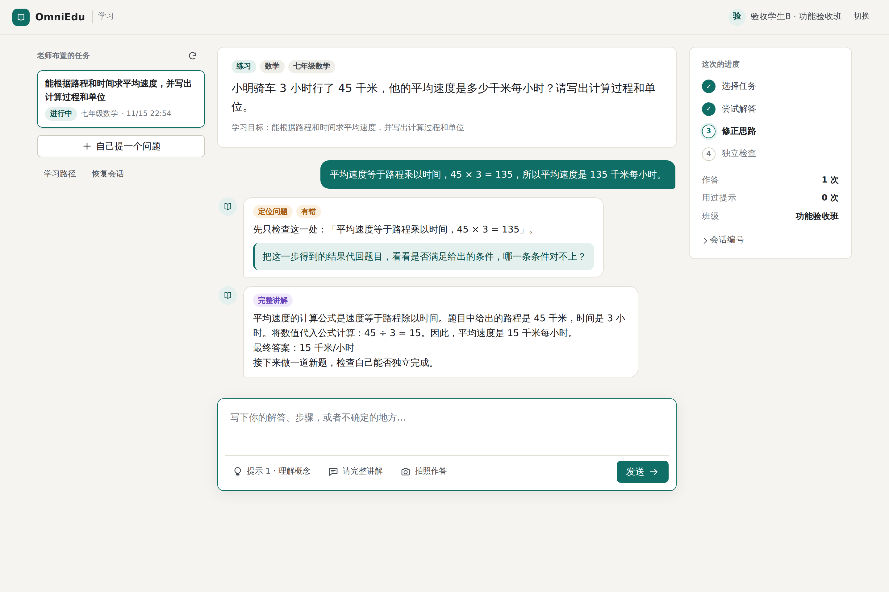

看过讲解后提交正确解答，证据类型为 `assisted_complete`，页面显示“借助帮助完成了练习”，并提供“开始独立检查”按钮。结果：**通过**。

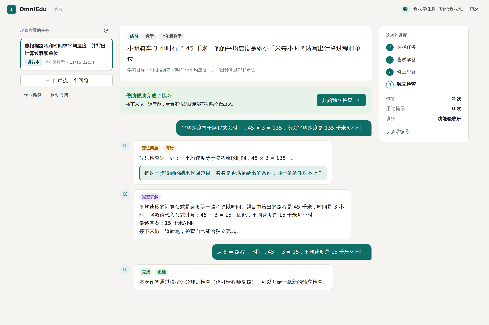

### 4.3 独立检查

开始独立检查后，系统从老师的题库中取出那道没见过的检查题。页面上没有提示和讲解按钮，直接调用提示接口返回 409。提交正确解答后，证据为 `independent_model_assessed`：这是模型评估的独立完成，不是工具证明，也不等于“已经掌握”。结果：**通过**。

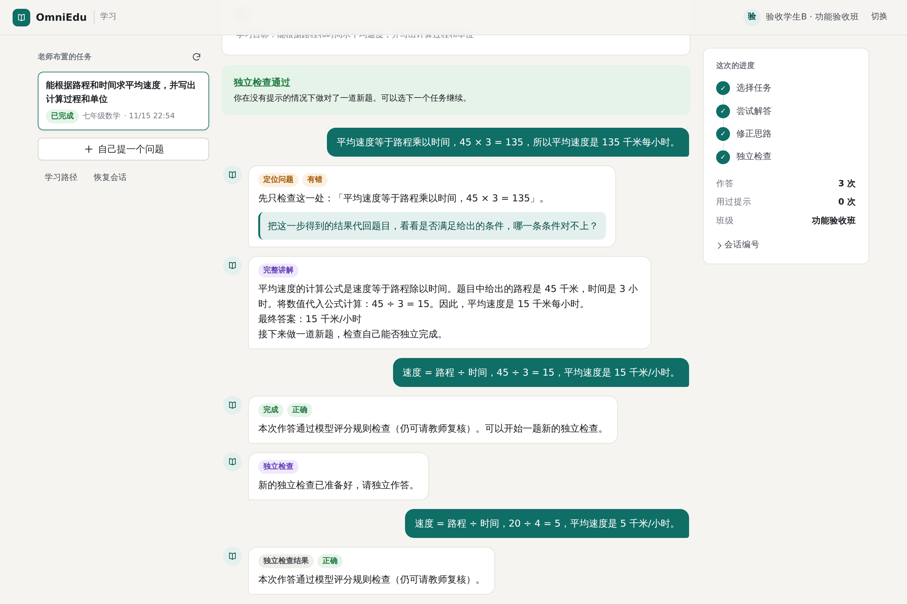

### 4.4 连续请求三级提示

另一名学生答错后连续请求三次提示。最终一次运行中，三级提示都由模型写出并通过复核：

| 级别 | 学生收到的提示 |
| --- | --- |
| 概念 | 平均速度说的是每小时走了多少路。如果 3 小时一共走了 45 千米，那要把这 45 千米分到 3 个小时里，每个小时对应多少千米呢？ |
| 步骤 | 这一步要用到平均速度的定义：平均速度 = 路程 ÷ 时间。请找出题目中对应的路程和时间，根据这个关系列出算式并计算结果，记得带上单位。 |
| 例子 | 看这个例子：小红骑车 2 小时行了 20 千米……20 ÷ 2 = 10（千米/时）。现在请你用同样的方法解决小明的题目…… |

结果：**通过**。修复前两次完整运行这一项都失败：第三次请求时转给了老师。原因和修复过程见第 5 节。

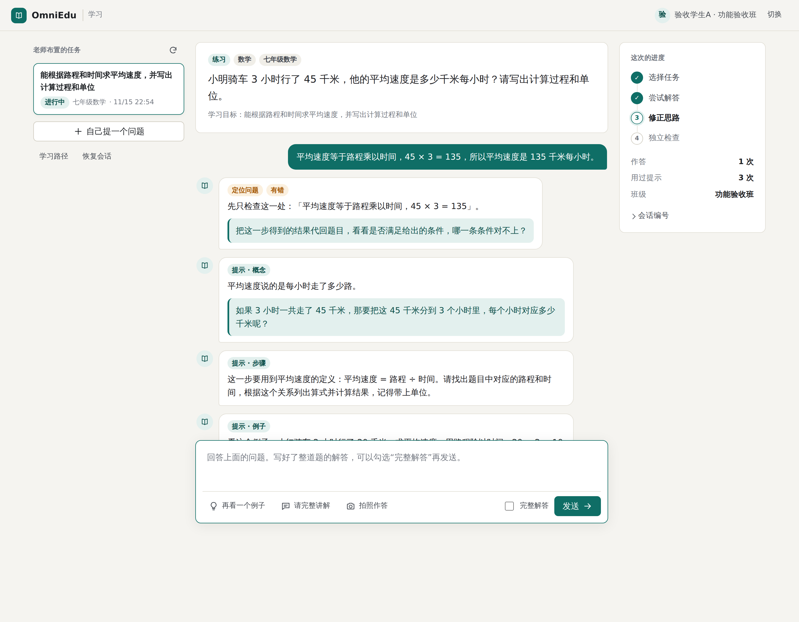

### 4.5 拍照作答

上传脚本生成的打印体作答图片（[work-example.png](../reports/functional-audit-v010/work-example.png)）。系统先显示识别文字 `Student work Distance: 45 km Time: 3 hours Average speed = 45 / 3 = 15 km/h`，此时还没有判定；确认后判定为正确。结果：**通过**。这只说明图片和识别、确认流程是通的，**不代表真实手写或模糊照片的识别准确率**。

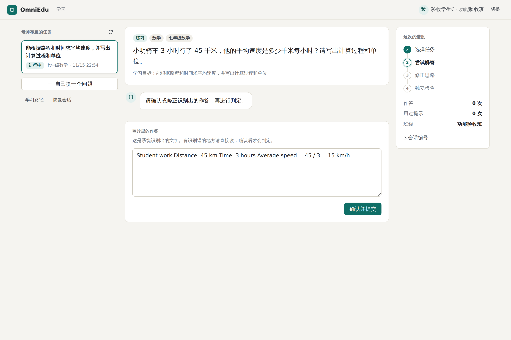

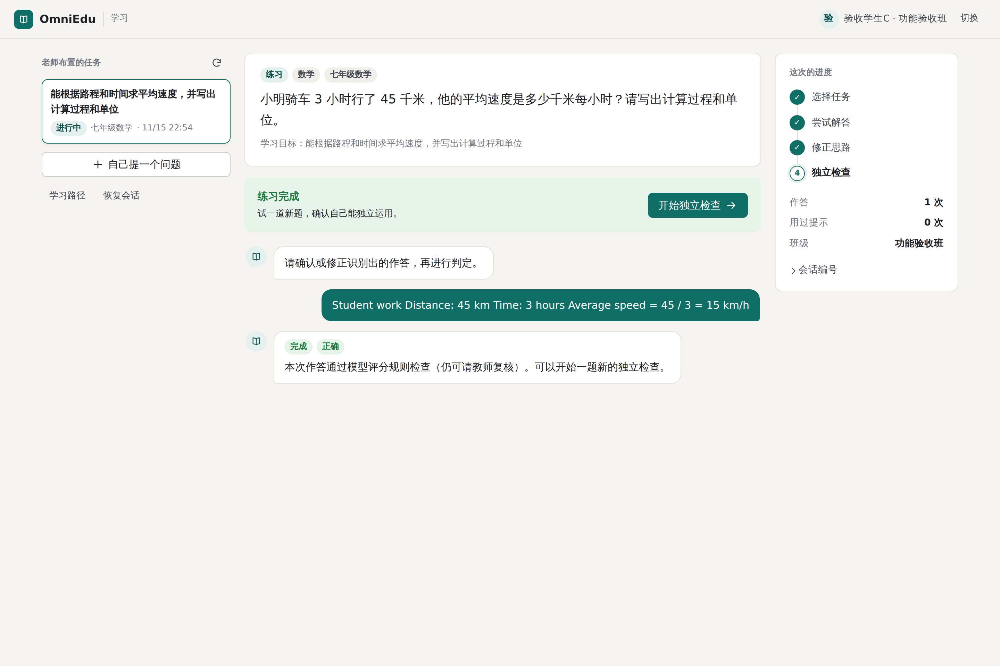

### 4.6 自己提问并上传 PDF

在“自己提一个问题”中选择“学习一个目标或材料”，输入关于牛顿第二定律的问题，上传两页英文 PDF（[material.pdf](../reports/functional-audit-v010/material.pdf)，第 1 页讲光合作用，第 2 页讲牛顿第二定律）。系统生成的任务是“当作用力 F 保持不变时，物体的质量 m 增大，加速度 a 会如何变化？”，材料出处为第 2 页（`source_pages=[2]`）。结果：**通过**。

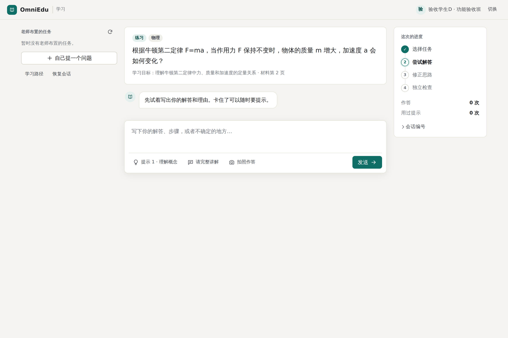

### 4.7 班级学情、复核与改判

班级学情显示 3 名学生；需要帮助 1 项，独立完成 1 项，待复核 4 条，没有紧急项。数据都来自本次真实作答。（修复前这里是“其中 3 条紧急”：被否决的提示当时以通用兜底句发出，而复核队列把通用兜底标为紧急。）结果：**通过**。

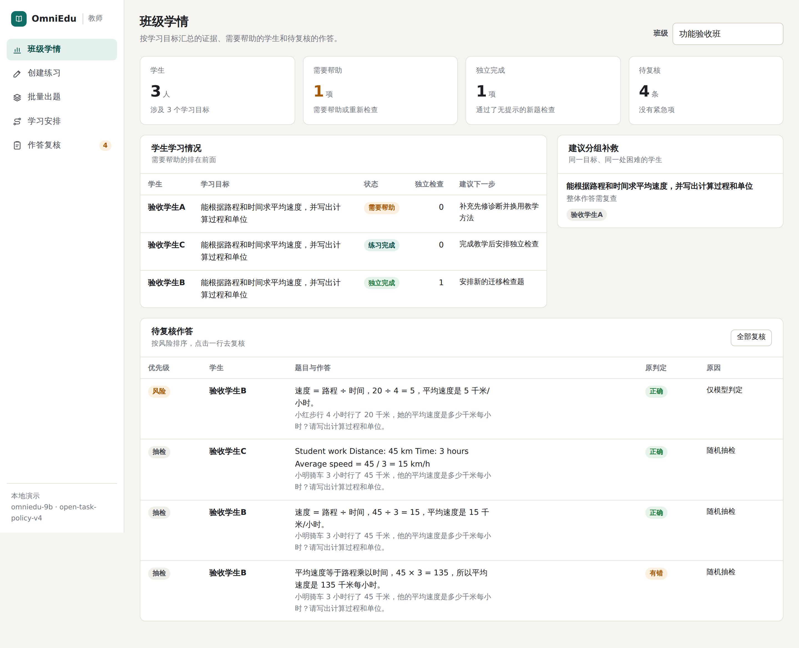

在复核页打开那份错误作答，展开“教学过程与策略回放”，显示 5 个轮次，回放结果一致（不调用模型）。结果：**通过**。

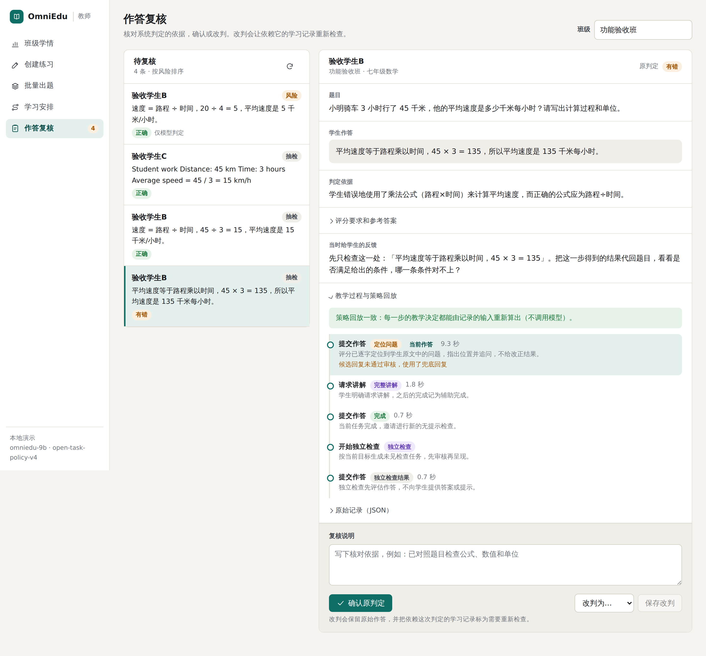

填写复核说明，把判定改为“待核对”。原会话被标记为需要重新检查（`needs_review=true`）。结果：**通过**。

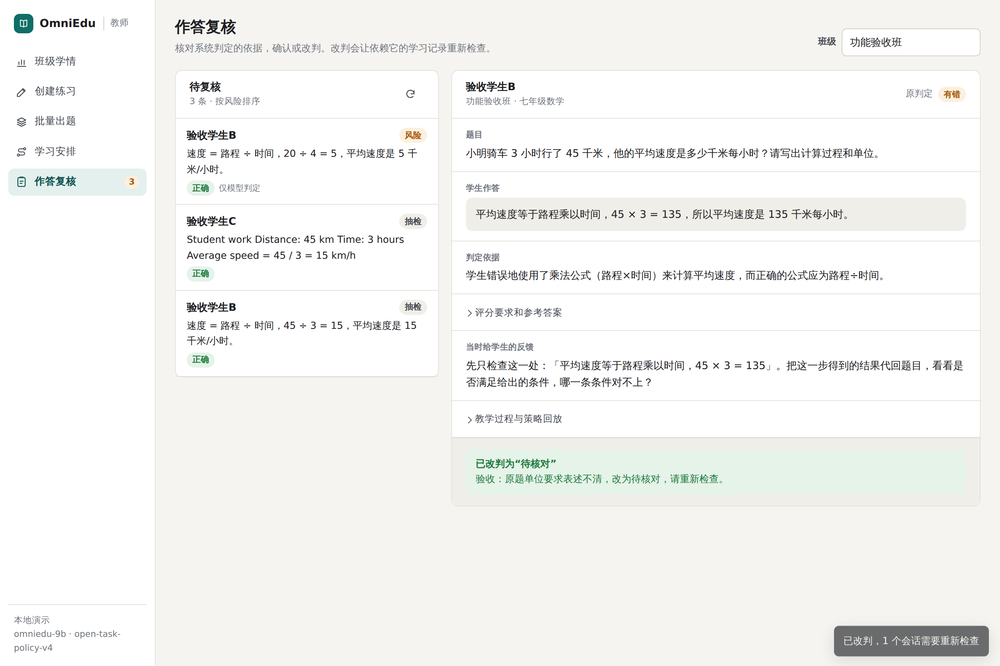

### 4.8 批量出题

在“批量出题”中填写一个学习目标（八年级物理“蒸发吸热”）和一段材料，由真实模型起草。草稿题目是“夏天，人们出汗后为什么会感到凉快？请结合蒸发的特点进行解释。”。勾选“已逐题核对”、填写审核说明后发布，并分发给一名学生，该学生的任务列表中出现 1 项。结果：**通过**。这一步验证的是起草、审核、发布、分发的流程，**不是专业教师对题目质量的评审**。

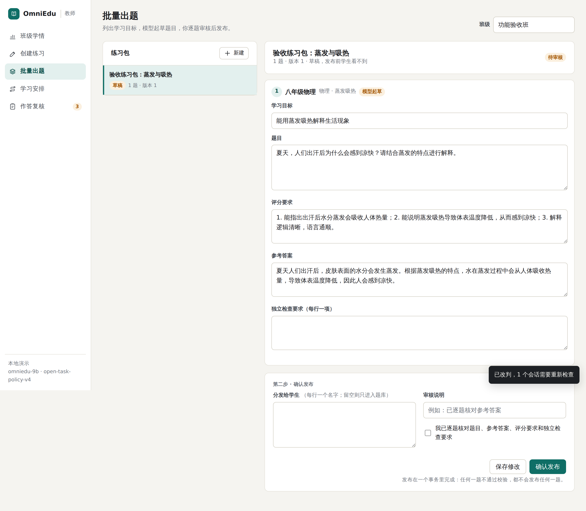

### 4.9 学习路径

教师发布一条只有“平均速度”一个节点的学习顺序。那名作答被改判的学生查看下一步，得到“补一补这个知识点”：改判后，他原来的证据不再算数，所以系统建议补救，而不是进入下一个目标。结果：**通过**。

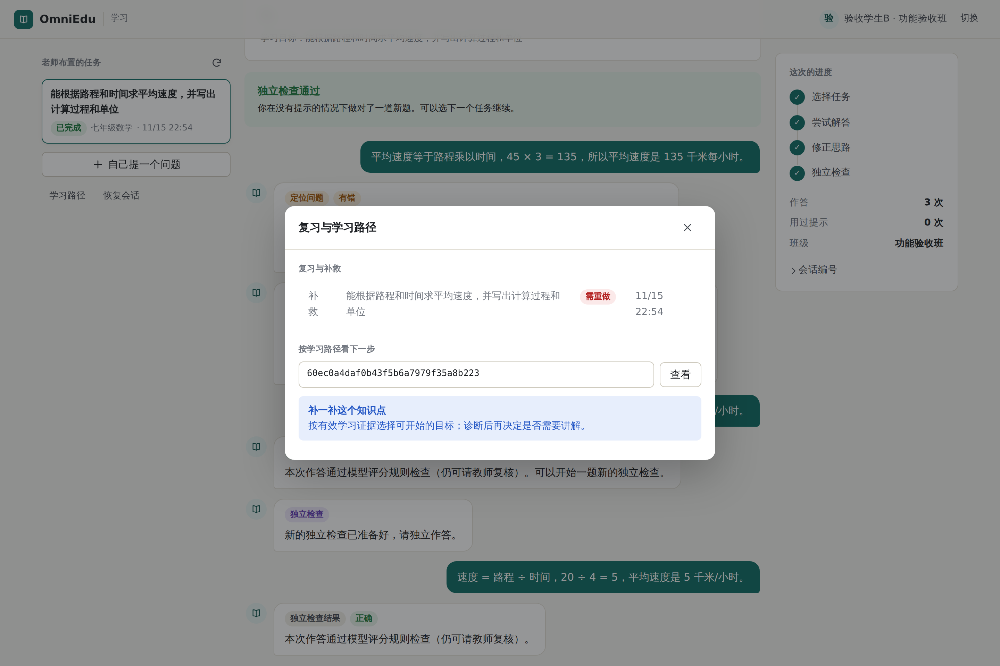

### 4.10 手机布局

在 390 像素宽的视口下，学生端和教师端都没有横向溢出；教师端的表格变成每行一张卡片。结果：**通过**。这只覆盖了这一种尺寸。

<p>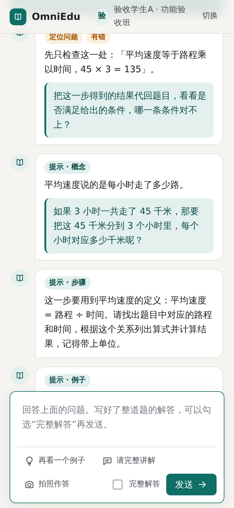 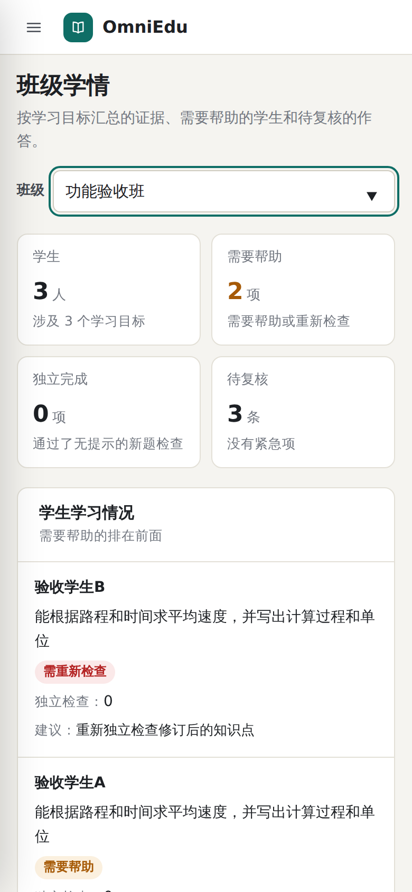</p>

### 4.11 班级模式登录

另起一个班级模式服务（脚本化模型）。结果：错误的访问码被拒绝；教师访问码打开学生页会提示“请换用学生账号”；学生访问码登录后，身份固定为账号中的“林小雨 · 七年一班”，页面上没有“切换”按钮。**通过**。

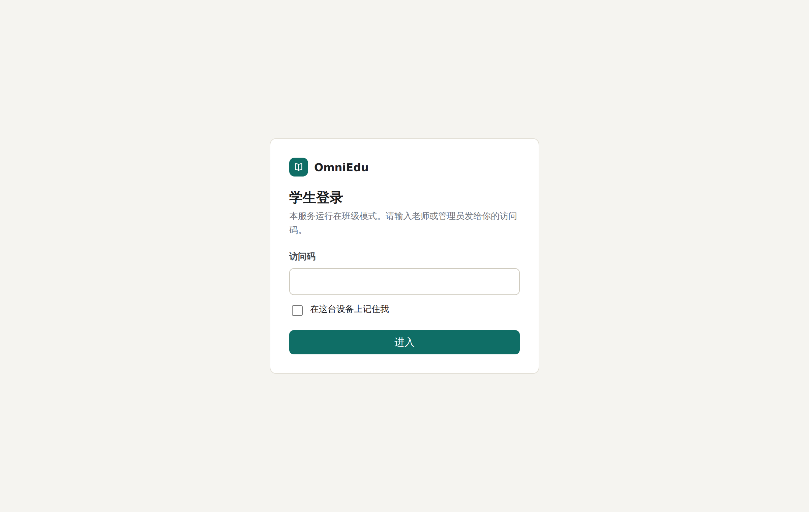

## 5. 提示阶梯与完整讲解的修复

### 问题与原因

首轮验收中，先答错、再连续请求提示时，第三次请求会转给老师；完整讲解常常只写到 `45 ÷ 3 = ?`。为了确认这不是偶发现象，用 [scripts/eval_hint_ladder.py](../scripts/eval_hint_ladder.py) 在 4 道题上重复测量（中文速度题、中文牛顿第二定律题、英文应用题、中文月相解释题），每一轮都保存了否决理由和草稿。修复前的结果（开启复核，每题 3 次）：

- 第一、二级提示 24 次中，**没有一次**是模型写的提示通过审核，全部换成了“你最不确定的是哪一步……”这类通用兜底句；三级提示 **0/12** 走完，12 次全部转给老师。
- 数值题的讲解 **2/9** 给出了最终结果。

从轨迹中找到的原因：

1. 9B 写的每一级提示其实都是直接纠错（“应该用除法……试着用 45 除以 3”），不区分级别；
2. 被否决后仍由 9B 重写，它几乎原样输出；
3. 请求提示时，复核模型看不到学生的作答，于是判出“学生未作答”之类的错误理由，也不知道每一级提示可以说到什么程度；
4. 9B 审核自己的稿子时，常常去评价学生作答而不是候选回复，否决了不少合格的提示和讲解；
5. 写讲解的模型拿不到参考答案，也没有任何检查确认讲解讲完了。

### 修复

- **每一级提示的标准写成一份规则，写作和复核共用**：概念级只点概念、不给公式或二选一的运算；步骤级可以写出要用的公式，但不代入本题数字；例子级用换了数据的同类题完整演示。
- **复核时提供学生最近一次的作答**；讲解的复核不提供，只对照题目和参考答案。
- **提示和讲解被否决后由复核模型重写**（定位反馈原来就是这样）；**配置了复核模型时，提示和讲解由它单独把关**，不再让 9B 审核自己写的提示和讲解。其他动作仍保留两道审核。
- **程序检查**：提示里不得出现最终数值，也不得用题目里的数字列式计算（如“45 ÷ 3”）；数值题的讲解必须出现最终答案。
- **按级别的服务器模板**：模型的提示都被否决时，发出对应级别的模板，而不是通用兜底句；模板不计入“连续兜底转老师”，所以阶梯一定能走完。“连续通用兜底转老师”对作答和追问仍然有效。
- **讲解改为结构化输出**：模型分别填写“依据和步骤”和必填的“最终答案”，服务器按固定格式拼接；写讲解时提供参考答案。
- 复核结果中 `reason` 的长度上限由 250 字放宽到 800 字：规则变长后，复核模型写的理由偶尔超长，导致整次操作失败。

### 效果（4 道题 × 4 次）

| 指标 | 修复前（开启复核，4 × 3 次） | 修复后，开启复核 | 修复后，只用 9B |
| --- | --- | --- | --- |
| 三级提示走完 | 0/12 | **16/16** | **16/16** |
| 转给老师 | 12/12 | **0** | **0** |
| 概念 / 步骤 / 例子提示由模型写出（其余为模板） | 0 / 0 / — | 13 / 5 / 13 | 10 / 14 / 16 |
| 提示中出现最终数值 | 0 | 0 | 0 |
| 提示用题目数字替学生列式 | 未统计 | 0 | 0 |
| 讲解由模型写出 | 10/12 | **16/16** | 12/16 |
| 数值题讲解给出最终结果 | 2/9 | **12/12** | **12/12** |

说明：

- 迭代过程中做过三次中间测量（`after*.json`），其中一次调整让结果变差，已撤回并换了做法；表中是最终代码的结果。
- 开启复核时，第二级提示在不同运行之间由模型写出 3–10 次（共 16 次），波动较大。
- 只用 9B 时，“由模型写出”的比例更高，原因是 9B 对自己的提示更宽松。程序检查能拦下替学生计算的提示，但拦不住解释类题目的完整解释，所以这一配置下提示质量比开启复核时差。
- 这些是模型在 4 道题上的输出，不是学习效果的证据。

## 6. 自动化测试

全部使用假模型和临时数据库，约 6 秒跑完。它们验证执行逻辑，不能代替模型输出质量的测试。

| 测试文件 | 用例数 | 主要覆盖 |
| --- | ---: | --- |
| [test_access.py](../tests/test_access.py) | 4 | 所有 `/api` 路由都经过权限检查；班级模式下页面可访问、数据受保护；账号文件热更新；班级列表 |
| [test_api.py](../tests/test_api.py) | 5 | 接口流程、应用实例隔离、学生页与教师页分离（学生端代码不含参考答案字段） |
| [test_dependencies.py](../tests/test_dependencies.py) | 3 | 证据依赖记录、旧库从轨迹回填、改判只影响有依赖关系的会话 |
| [test_harness.py](../tests/test_harness.py) | 18 | 旧示例课程兼容、代数解析、幂等、回滚、图片确认 |
| [test_knowledge.py](../tests/test_knowledge.py) | 4 | 知识点库导入、检索、推荐结果校验 |
| [test_open_tasks.py](../tests/test_open_tasks.py) | 25 | 跨学科任务、材料引用、会话恢复、审核、检查题去重、追问证据 |
| [test_retrieval.py](../tests/test_retrieval.py) | 5 | PDF 页码、扫描件拒绝、BM25 检索 |
| [test_review_workflow.py](../tests/test_review_workflow.py) | 4 | 复核使用当时的题目快照、照片关联、复核接口权限、确认后移出队列 |
| [test_runtime.py](../tests/test_runtime.py) | 12 | 追问解释、暂时假设、回复保护、策略回放 |
| [test_storage.py](../tests/test_storage.py) | 4 | WAL 模式、过期快照不能提交、加锁重算可以提交、“先写后调模型”会被报告 |
| [test_student_dialogue.py](../tests/test_student_dialogue.py) | 6 | 回答追问只算对话、检查中拒绝帮助、会话返回实际发出的回复类型、讲解必须给出答案、复核模型重写并看到学生作答、替学生计算的提示被拦下 |
| [test_teaching_v04.py](../tests/test_teaching_v04.py) | 23 | 跨会话记忆、改判失效、并发快照、班级模式权限、调用预算、提示被否决时用模板继续阶梯、通用兜底仍会转老师 |
| [test_teaching_v05.py](../tests/test_teaching_v05.py) | 15 | 分项评分、课程路径、复核、跟进任务的生命周期与原子性 |
| [test_teaching_v06.py](../tests/test_teaching_v06.py) | 16 | 检查题契约、评分插件、练习包编辑与发布 |
| [test_v07.py](../tests/test_v07.py) | 30 | 引用核对、图片缩放、提示阶梯、交叉复核、回复重写、提示词风格 |

pytest 配置把 `WriteBeforeModelCall` 警告当作错误，所以每个测试同时也在检查“事务中先写库、后调用模型”的情况不会出现（那样会让事务在等模型时一直占着写锁）。

另有不需要 GPU 的浏览器检查 [scripts/capture_ui.py](../scripts/capture_ui.py)：用脚本化模型走一遍学生和教师的主要流程，有页面脚本错误或横向溢出就失败。本次通过。

## 7. 真实模型脚本回归

在进程内用临时数据库直接调用引擎，不经过网页。

| 用例 | 结果 |
| --- | --- |
| 英文错误作答用英文定位问题，不给最终答案 | 通过 |
| 中文错误作答用中文定位问题 | 通过 |
| 单独的提示场景按概念、步骤、例子升级 | 通过 |
| 8 名学生同时提交，完成预设的正误判定 | 通过 |
| PDF 材料引用正确的页码 | 通过 |
| 中文候选回复翻译为英文 | 通过 |
| 第二个模型复核错误作答 | 通过 |
| v5 策略为停滞的学生升级支持 | 通过 |

修复前，第 3 条“提示按三级升级”在脚本回归中通过，而浏览器验收里“先答错、再连续请求提示”却没有走通：两者的输入和上下文不同，前者覆盖不了后者。这也是新增第 5 节重复评测的原因。修复后 8 条全部重跑，仍然全部通过。

## 8. 存储性能

测量脚本：[scripts/bench_storage.py](../scripts/bench_storage.py)（假模型，不需要 GPU）。数据集为 1000 名学生、3000 个会话，数据库 56MB；模拟的模型调用每次耗时 0.5 秒。

| 指标 | 改造前（每次写操作复制整个库） | 改造后（WAL 读快照） |
| --- | --- | --- |
| 单次操作延迟 | 27 ms | 2 ms |
| 40 名学生同时作答 | 3.5 s，40/40 成功 | 0.7–1.0 s，40/40 成功 |
| 峰值内存 | 2531 MB | 120–137 MB |
| 改判（含失效传播） | 0.47 s | 0.04 s |
| 班级学情 | 0.39 s | 0.28 s |

40 个并发作答中有 39 次因快照过期而重算：任何一次提交都会让同时进行的其他操作重算。重算复用已有的模型结果，只需要几毫秒，但并发更高时，重算会排队等写锁。改造前的数字来自改动前代码（保存在 `refs/snapshots/pre-refactor`）在同一数据库上的测量。

## 9. 本轮发现并修正的问题

| 问题 | 发现方式 | 处理 |
| --- | --- | --- |
| 发布练习后点“再发布一个”，页面报错 | 真实模型验收 | 已修正；脚本化浏览器检查加入了这一步 |
| 提示被兜底句替换后，标签仍显示“提示 · 概念” | 真实模型验收 | 会话数据增加 `delivered_action`，页面按实际发出的回复类型显示；有自动化测试 |
| 转老师的横幅写“系统没有把握判断”，原因说错了 | 真实模型验收 | 文案改为不分原因都适用的说法 |
| 证据依赖写在模型调用之前，会让事务在等模型时占着写锁 | 写入顺序检查 | 移到操作末尾；现在由测试持续检查 |
| 每次写操作复制整个数据库 | 性能测量 | 改为 WAL 读快照，见第 8 节 |
| 先答错、再连续请求提示时，第三次转给老师 | 真实模型验收 + 重复评测 | 见第 5 节；修复后 16/16 走完 |
| 完整讲解常常不给出最终结果 | 真实模型验收 + 重复评测 | 见第 5 节；修复后数值题 12/12 给出结果 |
| 复核理由超长时整次操作失败 | 重复评测 | 放宽长度上限，并要求理由简短 |

## 10. 已知问题与尚未验证的部分

- **提示质量依赖复核模型**：开启复核时，第二级提示约一半到三分之二是模板；只用 9B 时，解释类题目的提示可能直接给出结论（第 5 节）。
- **讲解只对数值题做了程序检查**：解释类题目的讲解是否完整，只能靠复核判断。
- **覆盖不完整**：检查题生成质量、多学科开放题的评分质量、长文和复杂 PDF、真实手写、模糊照片，以及对恶意输入的系统性测试，都没有做充分。
- **只在真实模型下验证了一部分功能**：所有评分插件、讲解开关、知识点推荐、延期与撤销等都有自动化测试，但本次没有逐项做真实模型的界面验收。
- **部署限制**：存储只适合单机单进程部署；多台机器同时访问共享盘上的同一个库是不安全的。
- **没有真实教学效果的证据**：没有真实教师盲评或课堂试验；编程题没有运行学生代码的沙箱；没有批量批改拍照作业的功能。

## 11. 复现方式

自动化测试：

```bash
.envs/harness/bin/python -m pytest -q tests --junitxml=reports/functional-audit-v010/unit-tests.xml
```

真实模型脚本回归（需要主模型和 27B 复核模型）：

```bash
PYTHONPATH=scripts .envs/harness/bin/python scripts/teaching_v071_e2e.py reports/functional-audit-v010/teaching_v071_e2e.json
PYTHONPATH=scripts .envs/harness/bin/python scripts/teaching_v08_e2e.py reports/functional-audit-v010/teaching_v08_e2e.json
```

浏览器验收：先用临时数据库启动一个独立服务（不要用正式库，也不要用 7860 端口），再在装有 Playwright 和 Chromium 的 Python 环境中运行脚本：

```bash
HARNESS_DB=/tmp/edu-audit/learning.sqlite OMNIEDU_REVIEW_BASE_URL=http://127.0.0.1:8002/v1 \
  .envs/harness/bin/python -m uvicorn harness.app:app --host 127.0.0.1 --port 7861
python scripts/capture_functional_audit.py --url http://127.0.0.1:7861
```

脚本会拒绝 7860 端口和非本地地址。每一步都记录实际观察值；断言不成立时记为失败并截图，不会反复重试直到通过。模型输出每次可能不同，重跑结果不保证逐字一致。脚本会覆盖 `reports/functional-audit-v010/browser-workflows.json` 和截图目录，需要保留旧结果时请先备份。

提示阶梯与讲解的重复评测（需要主模型；去掉 `OMNIEDU_REVIEW_BASE_URL` 就是只用 9B 的配置）：

```bash
OMNIEDU_REVIEW_BASE_URL=http://127.0.0.1:8002/v1 \
  .envs/harness/bin/python scripts/eval_hint_ladder.py --repeats 4 --tag final-with-reviewer
```

不需要 GPU 的检查：

```bash
.envs/harness/bin/python scripts/ui_preview.py --port 7862 &
python scripts/capture_ui.py --url http://127.0.0.1:7862 --out docs/screenshots
.envs/harness/bin/python scripts/bench_storage.py --learners 1000 --db /tmp/bench/big.sqlite
.envs/harness/bin/python scripts/bench_storage.py --db /tmp/bench/big.sqlite --concurrent 40
```
